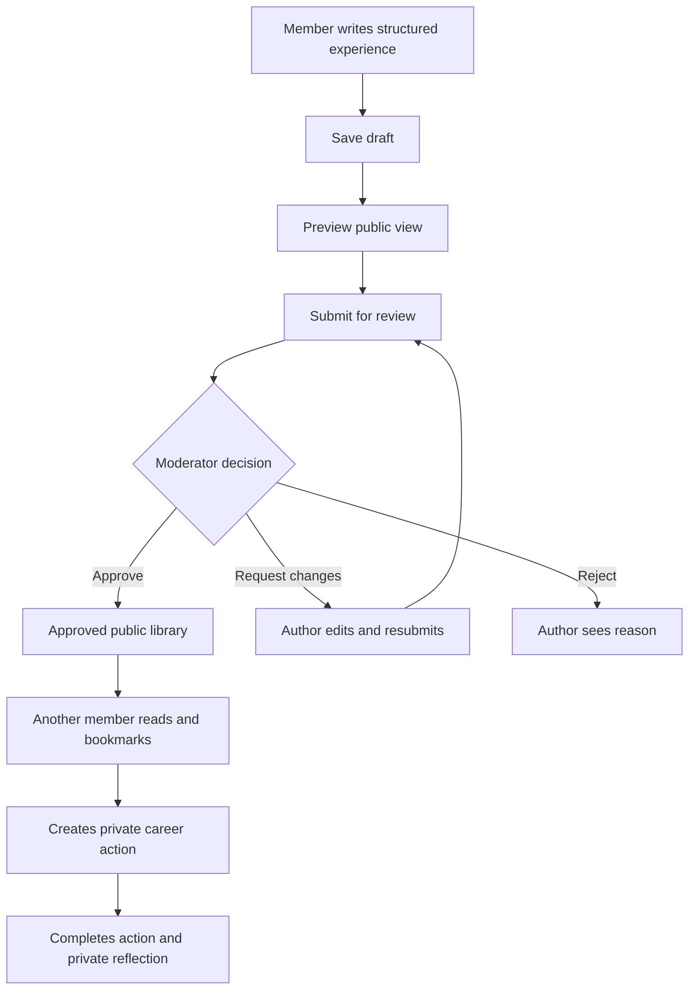
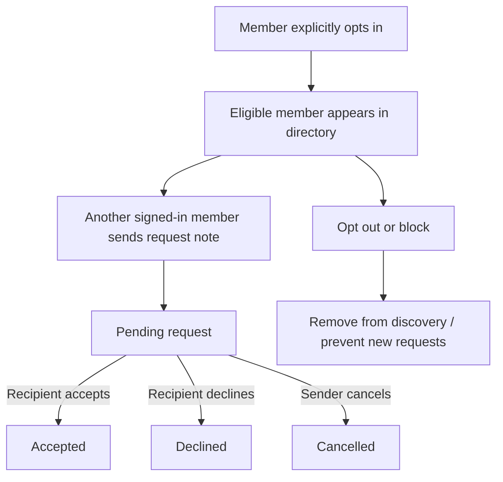

# Career Club Connect — Design Consistency Audit & Implementation Blueprint

**Document:** CCC-DESIGN-AUDIT-001  
**Version:** 1.0 — proposed decisions for sign-off  
**Prepared:** 15 October 2026  
**Target demo:** 6 November 2026  
**Stage:** DESIGN REVIEW ONLY — NO CODE IMPLEMENTED  
**Source baseline:** `CAREER_CLUB_CONNECT_MASTER_SPEC.md` v1.0 and `PROJECT_BLUEPRINT.md`, plus 12 mobile and 6 desktop concept boards.

> **Demo integrity:** All participant names, profiles, stories, discussions, statistics, and outcomes shown in demo content are fictional. The application is an independent student/team prototype, not an official City of Espoo service. Do not imply organizer endorsement, verified alumni membership, or real adoption.

## 1. Purpose, authority, and review outcome

The concept boards are **visual references**, not executable specifications. Some include extra features, inconsistent labels, unsupported controls, misleading data, and different privacy behavior. This audit identifies those conflicts and proposes one buildable interpretation. **No visual detail overrides security, data ownership, the approved balanced MVP, or a written acceptance criterion.**

**Document hierarchy:** (1) explicit approved product decisions and this signed-off audit; (2) master product/engineering specification; (3) API/schema/permissions contracts; (4) reviewed visual concepts; (5) image-generation details, which have no independent authority. When documents conflict, record an issue and update the source of truth; do not silently choose whichever version is easier to code.

**Audit outcome:** Visual direction accepted provisionally; architecture and product behavior can be locked after decisions in §20 are approved. Some mockups cannot be pixel-audited from text alone; the audit is **functional and cross-screen consistency**, with pixel-level QA required during implementation.

## 2. Product promise and the balanced MVP

**Promise:** Help current and future Career Club participants discover structured, consented career experiences; ask and answer practical questions; optionally request professional coffee conversations; and turn learning into personal career actions.

**Problem hypothesis:** Career lessons may be lost or hard to find between Career Club rounds. This remains unvalidated until organizer and participant interviews; it is not an established fact about the City of Espoo.

### Scope tiers

| Tier | Capability | Demo acceptance |
|---|---|---|
| P0 | Email/password sign-up/sign-in, logout, permissions | Session persists securely; users cannot access others' private records |
| P0 | Profile + onboarding | Profession, interests, optional self-reported round, optional LinkedIn, private-by-default visibility |
| P0 | Experience Library | Approved-only search/filter/detail, helpful mark, bookmark |
| P0 | Experience authoring | Draft → preview → submit → moderator decision; resubmission after changes |
| P0 | Career goals/actions | Create/edit/complete; optional story source; private reflection; owner-only |
| P0 | Moderation | Experience queue, reasoned decisions, reports, audit records |
| P0 | Responsive design, seed, deployment, tests | 390px/1024px/1440px; deterministic synthetic demo; HTTPS; CI |
| P1 | Community forum | Thread/reply, helpful, report, hide; no chat or nested comment trees |
| P1 | Coffee Buddy | Opt-in directory, request note, accept/decline/cancel, block/report |
| P1 | PWA | Manifest/install prompt where supported; privacy-safe caching |
| P1 **conditional** | Basic in-app notifications | Only if P0/P1 core flows stable; database-backed inbox, read/unread, links; no push/email/realtime |
| LATER | Following, direct chat, matching algorithm, badges, social feed, public polls, event directory, AI, photo upload, calendar booking, OAuth | Do not render as active functionality in the MVP |

**Change from master spec:** Basic notifications were originally `LATER`; visual Screen 10 and Desktop 5 proposed them. They are now **conditional P1**, not guaranteed. This is a change request requiring owner sign-off (CR-001). If not approved, show no bell/unread count or a disabled prototype label only in design materials, never a fake live control.

**Cut order if time runs short:** notifications → PWA extras → Coffee Buddy → forum. Never cut object permissions, moderation of published experiences, privacy, or deployment verification to preserve a decorative feature.

## 3. Locked information architecture

### 3.1 Navigation

**Mobile bottom bar (exactly five):** `Home | Explore | Community | Actions | Profile`.

- **Explore** contains tabs/links to `Experiences`, `People / Coffee Buddy`, and saved experiences; do not add a sixth bottom item.
- **Coffee Buddy** also has a prominent home shortcut. A request screen is a child of Coffee Buddy.
- **Notifications** open from a top-bar bell *only if CR-001 ships*.
- **Moderator** entry appears under Profile/account menu for authorized staff, not in ordinary member navigation.
- **Settings** under Profile; sign-out under account menu/settings.
- **Experience contribution** entry from Experience Library and relevant contextual actions.

**Desktop sidebar:** `Home | Explore / Experiences | Community | Coffee Buddy | My Actions | Profile`; below: `Settings`, `Help`, and `Moderation` only for authorized roles. Desktop top bar: global search, conditional notifications, account menu. Active destination and page title must agree.

**Tablet (~1024px):** compact/collapsible sidebar, never simultaneous cramped three-column layout. Mobile bottom bar returns at narrower widths; no route changes or business-rule changes.

### 3.2 Route map (proposed)

| Page | Path | Access |
|---|---|---|
| Landing/guest exploration | `/` | Everyone |
| Sign up / login / reset | `/register`, `/login`, `/forgot-password`, `/reset-password` | Guests (with safe redirects for signed-in users) |
| Onboarding | `/onboarding` | Signed-in |
| Home | `/home` | Signed-in |
| Explore | `/explore` | Everyone, privacy-filtered |
| Experiences / detail / create / edit | `/experiences`, `/experiences/[id]`, `/experiences/new`, `/experiences/[id]/edit` | Public approved read; member write |
| Community / detail / create | `/community`, `/community/[id]`, `/community/new` | Public visible read; member write |
| Coffee directory / profile / requests | `/coffee`, `/coffee/[id]`, `/coffee/requests` | Signed-in, eligibility/opt-in enforced |
| Actions / action detail | `/actions`, `/actions/[id]` | Owner only |
| My profile / public profile | `/profile`, `/members/[id]` | Owner / consent-filtered |
| Settings | `/settings` | Owner only |
| Notifications | `/notifications` | Owner, only if shipped |
| Moderation | `/moderation`, `/moderation/experiences/[id]`, `/moderation/reports`, `/moderation/members` | Moderator/admin |
| Legal / help / system | `/privacy`, `/terms`, `/help`, `/403`, `/404` | As appropriate |

**Deep links:** direct reload of every route must work; unauthenticated writes redirect to login and then back to intended action when safe. A hidden/deleted resource returns a generic unavailable/404 response, not its private metadata.

## 4. Cross-design contradictions and resolutions

| ID | Observed conflict in concepts vs. baseline | Decision | Severity |
|---|---|---|---|
| A01 | Mobile sometimes includes Coffee Buddy in bottom nav | Five fixed mobile tabs; Coffee Buddy under Explore + home shortcut | High |
| A02 | Desktop switches `Explore`/`Experiences` names | Display `Explore` in global nav; page title `Experience Library` on subpage | Medium |
| A03 | Follow/follower buttons and counts | Remove: not an approved social graph | Medium |
| A04 | Coffee Buddy appears like a chat/messenger | Request note + status only; no ongoing messaging | High |
| A05 | Some screens expose phone or email | Remove from public profiles/directories and signup unless email required for account | Critical |
| A06 | Mockups show real-looking alumni photos | Use initials/illustrated synthetic avatars; do not imply actual people | High |
| A07 | Mockups show real LinkedIn links on fictional people | Synthetic profiles have disabled demo link or no link; real URL only user-supplied in later pilot | High |
| A08 | Self-selected Career Club round shown as verified | Show `Self-reported` until moderator/admin verifies with an approved process | Critical |
| A09 | Some screens default to publicly visible profile | Private/unlisted by default; explicit visibility opt-in | Critical |
| A10 | Anonymous story still shows author photo/name/LinkedIn | Anonymous to public, including cards, detail, search, comments/related links, API | Critical |
| A11 | Some stories publish immediately | All experiences require moderator approval | Critical |
| A12 | Some forum mockups show anonymous posting | **Defer anonymous forum posts** in MVP; signed-in display name required, reducing abuse and policy complexity | High |
| A13 | Forum includes nested replies/rich HTML | Flat comments; plain text or tightly sanitized limited Markdown | Medium |
| A14 | Notifications included in later mockups but master spec says LATER | Conditional P1 CR-001; no push/email/realtime | High |
| A15 | Some screens show unsourced adoption/usage statistics | Compute from database; mark seed counts fictional; no claims of real uptake | High |
| A16 | Search includes private profiles or draft stories | Approved public content only; member directory requires opt-in and login | Critical |
| A17 | Coffee availability shown as live/presence | `Open to coffee requests` preference only; no online-status tracking | Medium |
| A18 | Multiple save/bookmark patterns | One reusable bookmark interaction per content type; saved items in Explore/Profile as specified | Medium |
| A19 | Multiple action-status names | `Not started`, `In progress`, `Completed` across all devices | Medium |
| A20 | Different moderator queue statuses | `Draft`, `Pending`, `Changes requested`, `Approved`, `Rejected`, `Hidden` with defined transitions | High |
| A21 | UI shows admin can freely view private journals | Moderators cannot read private reflections; admins no routine access | Critical |
| A22 | Moderator screens include add-member/verified badges without evidence | No bulk alumni import; verification is a controlled optional administrative action | High |
| A23 | Signup suggests Google/LinkedIn OAuth | Email/password only; LinkedIn is an optional external profile URL | Medium |
| A24 | Account deletion appears instantaneous everywhere | Explicit confirmation + server process; retention exceptions explained, never fake completion | Critical |
| A25 | Designs show extra location field | Broad optional city/region only if justified; no precise address/geolocation | Medium |
| A26 | Mockups use inconsistent buttons, fonts and color | Central design tokens and shared component library; no per-module styling forks | Medium |

**Audit note:** Image-generated text may be misspelled, counts inconsistent, or controls impossible. Such artifacts are not approved copy or data contracts.

## 5. Design system — proposed locked tokens

All tokens must live in one shared theme file (CSS variables/Tailwind configuration). No literal hex values in feature components except approved token definitions.

### 5.1 Color

| Token | Value | Usage |
|---|---|---|
| `--color-brand-navy` | `#102B4E` | Logo, major headings |
| `--color-primary` | `#1769E0` | Primary buttons, active nav, links |
| `--color-primary-hover` | `#1257BD` | Primary hover |
| `--color-accent` | `#0D9488` | Selected positive accents |
| `--color-text` | `#17253B` | Main copy |
| `--color-text-muted` | `#5C6B7C` | Secondary copy (verify contrast) |
| `--color-border` | `#DCE4ED` | Dividers, input borders |
| `--color-page` | `#F6F9FC` | Background |
| `--color-surface` | `#FFFFFF` | Cards, modals |
| `--color-danger` | `#B42318` | Destructive actions/errors |
| `--color-success` | `#067647` | Confirmed success |
| `--color-warning` | `#9A6700` | Pending/caution; verify contrast |
| `--color-focus` | `#1769E0` | Visible focus ring |

Status must use **text + icon**, never color alone. Verify WCAG contrast on actual combinations; tokens are planning values, not a certification.

### 5.2 Typography and spacing

- **Font:** Inter with system sans-serif fallback; no proprietary or externally dependent font needed. Load self-hosted font or system stack in production.
- **Base body:** 16px / 1.5 line height. Small text 14px minimum for regular interface content; 12px reserved for nonessential labels only after accessibility review.
- **Heading scale:** H1 30–36px desktop / 26–30px mobile; H2 24px; H3 20px; card titles 16–18px. Use semantic heading order.
- **Spacing:** 4px base scale: 4, 8, 12, 16, 24, 32, 48, 64px. Page padding 16px mobile, 24px tablet, 32px desktop.
- **Radii:** input/button 8px; card 12px; modal 16px; pill 9999px.
- **Control sizes:** primary inputs/buttons min 44px height; touch target >=44x44 CSS px wherever feasible.
- **Shadows:** one subtle elevation for cards/popovers; never heavy gradients or unrelated styles by module.
- **Content widths:** 390px reference mobile; app max content width 1280px on wide desktop; long-form text column 680–760px for readability.
- **Motion:** 120–200ms restrained transitions; respect `prefers-reduced-motion`.

### 5.3 Responsive behavior

| Width | Layout | Navigation | Grid |
|---|---|---|---|
| 320–639px | Single-column mobile | Five bottom tabs + top actions | 1 card/row |
| 640–1023px | Large phone/small tablet | Bottom tabs or compact side rail according to fit | 1–2 columns |
| 1024–1279px | Tablet / small laptop | Collapsible side rail | 2 columns; filters collapse |
| >=1280px | Desktop | Persistent left sidebar + top bar | 2–3 cards; optional secondary panel |

Reference screenshots: **390px**, **1024px**, **1440px**. Test at 320px and 200% zoom for overflow. Responsive changes are presentation-only; API permissions and user capabilities remain identical.

## 6. Reusable component contracts

| Component | Variants / props | Required behavior |
|---|---|---|
| `AppShell` | guest/member/moderator, mobile/tablet/desktop | Consistent nav, content landmark, safe-area bottom padding |
| `TopBar` | title, search, notification, account | Hide notification control if feature not shipped |
| `MobileTabBar` | 5 fixed destinations, active route | Keyboard focus, accessible labels, no overlap |
| `DesktopSidebar` | main/utility/role-gated | Collapsible at tablet; no hidden unauthorized links |
| `Button` | primary, secondary, ghost, danger | default/hover/focus/disabled/loading; no double-submit |
| `TextField` / `Textarea` / `Select` | required/optional, hint/error | Explicit labels, inline errors, max lengths |
| `SearchBar` / `FilterPanel` | keyword, profession, topic, round, sort | Debounced or explicit search; clear all; URL query sync |
| `Card` / `ExperienceCard` | approved public record | Consistent title, tags, attribution/privacy, actions |
| `DiscussionCard` | public visible record | Topic, date, reply/helpful count; no private metadata |
| `MemberCard` | consent-filtered member | Opt-in status; optional LinkedIn; no phone/email |
| `ActionCard` / `ProgressBar` | own goal/action | Status from persisted records, no fabricated metrics |
| `Avatar` | initials fallback / optional illustrated demo | Stable initials and color, alt/accessible name |
| `StatusChip` | workflow status | Consistent text/icon and contrast |
| `NotificationItem` | conditional P1 | Owner-only, read/unread, deep link, safe fallback |
| `Toast` | success/error/info | Does not replace inline validation; announced accessibly |
| `ConfirmDialog` | destructive/stateful actions | Focus trap, clear consequence, confirm/cancel |
| `ReportDialog` | target, reason, optional detail | No public reporter identity; abuse controls |
| `Skeleton` / `EmptyState` / `ErrorState` | module-specific | Accessible loading, retry, meaningful next action |
| `Pagination` | page, count, size | Stable ordering, keyboard operable |

**Single ownership rule:** each component is maintained centrally; feature modules compose it rather than copy/paste markup. Create a component catalog page in development for visual QA.

## 7. Every-screen review (12 mobile concepts / 6 desktop boards)

| Design board | Locked primary user journey | Constraints and corrections |
|---|---|---|
| Mobile 01 Home | Welcome → browse experience / discuss / coffee / action | Real DB summaries; hide unshipped widgets |
| Mobile 02 Experience Library | Search/filter → open approved story → bookmark | No pending stories in public lists |
| Mobile 03 Community | Browse → post → reply/helpful/report | No anonymous posting or nested trees in MVP |
| Mobile 04 Coffee Buddy | Filter opted-in people → request → manage | No chat, presence or unconsented links |
| Mobile 05 Actions | Goal → actions → progress → private reflection | Owner-only; saved story can create action |
| Mobile 06 Profile | My profile/edit vs limited public profile | Visibility/LinkedIn opt-in; initials avatar |
| Mobile 07 Auth/Onboarding | Guest → account → interests/round → privacy → home | Round self-reported, no mandatory LinkedIn/photo |
| Mobile 08 Share Experience | Draft → preview → submit → moderation status | Anonymity must hold at API/search level |
| Mobile 09 Moderator | Review experience/report → decision → audit | Moderator access only; no private journal access |
| Mobile 10 Notifications | Read event → open related item | Conditional P1; no email/push/realtime |
| Mobile 11 Search & Explore | Search experiences, visible discussions, opted-in people | People search login-gated; no private data |
| Mobile 12 Settings | Account/privacy/export/delete/block | Real server action + confirmation, no fake completion |
| Desktop 01 Dashboard | Same Home journey, richer grid | Same nav labels, no extra features |
| Desktop 02 Experience Hub | Search → detail → story contribution | Same story states, same anonymity |
| Desktop 03 Forum | Thread → reply/helpful/report | Same flat comments and moderation |
| Desktop 04 Connect/Grow | Coffee → public profile → private action | Same opt-in/request rules; no following |
| Desktop 05 Auth/Notifications | Signup/onboarding and optional inbox | No unsupported OAuth; notification scope conditional |
| Desktop 06 Moderation/Privacy | Queue/reports/membership/settings | Role checks, audit events, rights requests |

## 8. User journeys and state machines

### 8.1 Knowledge relay (core)



**Experience statuses:** `draft → pending → approved`; `pending → changes_requested → pending`; `pending → rejected`; `approved → hidden` by moderator. Editing approved public content should create a revision requiring reapproval rather than silently modifying published text (implementation decision to finalize before coding). Rejected/hidden content never appears in public search.

### 8.2 Coffee Buddy



No self-request; no request to a blocked or non-opted-in recipient; one active request per pair; rate limit. On accept, show only information already separately opted into (e.g., LinkedIn), **not automatic email/phone disclosure**. No promise that a coffee meeting occurred.

### 8.3 Forum

Signed-in user creates a visible thread; members comment/helpful/report; moderator may hide reported content with reason. Reports are private; helpful is one per user/content; no public downvotes. Anonymous forum posting is out of scope, even if concept image includes a checkbox.

### 8.4 Career actions

User creates a goal/action manually or from an approved experience → `not_started → in_progress → completed` (allow reverting with audit/update timestamp) → optional private reflection. Progress is `completed actions / total actions` for that user's goal; if zero actions, show `No actions yet`, not 0% as if it were measured effort.

### 8.5 Notifications (conditional)

Domain event (reply, request status, experience decision) → owner-only notification record → unread inbox → tap deep link → mark read. No notification should reveal a hidden author's identity, moderation-only notes, or private content in a push/email channel (none planned). If a target is deleted, display `This item is no longer available`.

## 9. Data model and ownership boundaries

Keep the master spec's relational model as the starting schema. Confirm fields, indexes and state transitions during schema review; **do not infer database fields from visual mockups**.

| Domain | Entities | Ownership/privacy |
|---|---|---|
| Accounts | `users`, `profiles`, `career_rounds`, `round_memberships` | Email private; profile visibility opt-in; round self-reported until verified |
| Knowledge | `experiences`, `tags`, `experience_tags`, `experience_bookmarks`, `experience_helpful` | Author owns draft; public only approved; moderator controls publishing |
| Community | `discussions`, `comments`, `discussion_helpful`, `comment_helpful` | Visible content + moderation status; private report metadata |
| Connections | `coffee_requests`, `user_blocks` **(add)** | Request participants only; opt-in and blocks enforced |
| Actions | `career_goals`, `career_actions` | Owner-only, including reflections |
| Trust | `content_reports`, `moderation_events`, `privacy_consents` | Reporter and audit data restricted |
| Notifications | `notifications` **(conditional add)** | Recipient-only, link to authorized target |
| Privacy operations | `privacy_requests` **(add if async export/deletion)** | Requester/admin-only, limited retention |

**Database constraints:** unique normalized email; one profile per user; one helpful/bookmark per `(user, target)`; unique round membership; no self-coffee request; unique active coffee request pair; non-null ownership; indexed status/created_at/field/round; UUID public IDs; valid enum statuses; delete behavior explicit per relationship. Use transactions for moderation decisions and coffee transitions.

**Schema change requests:** `user_blocks` is needed because UI already promises block/unblock; notifications and privacy-request tracking are conditional/implementation-dependent. These must be added to the master ERD only after sign-off, with migrations and tests.

**Search:** PostgreSQL indexed filtering/full-text where useful; no Elasticsearch/AI engine. Unified Explore search returns only content each caller is authorized to see; public guests cannot enumerate Coffee Buddy profiles.

## 10. API boundaries and authorization

**Baseline:** Next.js + TypeScript frontend, Django REST Framework API `/api/v1`, PostgreSQL; same-origin reverse proxy preferred; secure HttpOnly session cookie and CSRF-protected writes. This remains a **proposed stack pending auth/deployment spike**, not a deployed fact.

**Domain endpoints** (see master spec for full list):

- `/auth/*`, `/me/profile`, `/me/privacy`, `/me/export`, `/me/delete-request` — identity and personal data.
- `/experiences/*`, `/experiences/{id}/submit`, `/experiences/{id}/bookmark`, `/experiences/{id}/helpful` — public knowledge and author actions.
- `/discussions/*`, `/discussions/{id}/comments`, `/reports` — community and reports.
- `/coffee/profiles`, `/coffee/requests`, `/coffee/requests/{id}/accept|decline|cancel`, `/me/blocks` — networking.
- `/goals`, `/actions`, `/actions/{id}` — owner-only career development.
- `/moderation/queue`, `/moderation/experiences/{id}/approve|request-changes|reject`, `/moderation/reports`, `/moderation/members` — staff only.
- `/notifications`, `/notifications/{id}/read`, `/notifications/mark-all-read` — **conditional P1**.

**Permission invariants:** backend queries must filter by approved/visible status; object permissions checked on detail/write; no client-provided `author_id`, `owner_id`, `role`, `verified`, `published_at`, or moderation status accepted as authoritative. Use `404` for concealed resources when appropriate; never expose hidden metadata in counts, autocomplete, OpenAPI examples, or errors.

**Contract discipline:** one OpenAPI contract; typed client generated or hand-written with contract tests; consistent pagination, error envelope, status enums and timestamps. Backend rejects invalid transitions with `409`; failed writes never display success. Additive versioned changes preferred.

## 11. Permissions matrix (server-enforced)

| Capability | Guest | Member | Author/owner | Moderator | Admin |
|---|---|---|---|---|---|
| View approved experiences | Yes | Yes | Yes | Yes | Yes |
| View own pending/rejected story | No | No | Yes | Review queue | Controlled |
| Publish/approve experiences | No | No | No | Yes | Yes |
| Create story/thread/comment | No | Yes | Yes | Yes | Yes |
| View hidden content | No | No | Own item as policy allows | For review | Controlled |
| View private actions/reflections | No | No | Own only | **No** | No routine access |
| View opted-in Coffee directory | No | Yes (eligible) | Yes | For safety purposes | Controlled |
| Send coffee request | No | Yes (eligible) | Yes | As member | As member |
| Accept/decline request | No | Recipient only | Recipient only | No override without safety policy | Controlled |
| Block/report | No | Yes | Yes | Yes | Yes |
| Edit personal settings | No | Own | Own | Own | Own |
| Verify round membership | No | No | No | If delegated | Yes |
| Read moderation audit/report details | No | No | No | Authorized scope | Authorized scope |
| View notifications | No | Own only | Own only | Own only | Own only |
| Request export/deletion | No | Own only | Own only | Own only | Own only |

**Moderator ≠ unrestricted admin.** Neither role automatically gains access to private reflections. Verification must be evidence-based and authorized; a seeded `Verified` badge in a fictional demo is clearly synthetic and must not suggest organizer validation.

## 12. Privacy, GDPR and safety controls

### Defaults and data classification

- **Private by default:** account email, password credentials, career actions/reflections, Coffee request messages/status, block lists, moderation reports, data-rights requests.
- **Opt-in public:** discoverable professional profile, selected bio/profession/interests, optional LinkedIn URL, named experience attribution, Coffee Buddy listing.
- **Public after moderation:** approved experience content, with anonymous or named attribution as chosen.
- **Forum:** visible signed-in display name for MVP; participants warned not to publish private contact information or sensitive personal data.
- **Synthetic-only demo:** fixed fictional profiles, initials/illustrations, no real photos, no live LinkedIn URLs to strangers, persistent demo banner.

### Anonymous experiences — strict contract

Anonymity is **relative to public viewers**, not to the operator/moderators who must handle abuse and legal requests. Public cards/detail/search/author links/API must not include author ID, name, avatar, LinkedIn, or cross-linking clues for anonymous publication. Moderator may see true author identity in a restricted review interface. Tell authors that their story text itself may identify them; provide preview and guidance to remove identifying details.

### Real pilot prerequisites (not solved by a settings page)

Identify actual data controller and contact; determine lawful bases and notice; agree processing agreements/hosting regions/transfers; define retention, backup deletion and rights handling; decide moderation owner; secure accounts and logging; incident response; assess DPIA need; validate organizer permission for name/branding and any alumni outreach. Do **not** assume GDPR compliance merely because the UI includes export/delete buttons.

### Rights workflows

- Export: authenticated request; generate scoped machine-readable export or a documented fulfillment workflow; never export other users' private data.
- Deletion: reauthentication/confirmation as appropriate; explain effect on authored content, comments, moderation audit, backups and legal exceptions before execution. Do not promise instant irreversible deletion if backend cannot guarantee it.
- Withdraw visibility/coffee opt-in: immediately stop new public discovery; handle existing requests under an explicit policy.
- Password/email changes: reauthentication or verified email flow, session rotation, rate limiting and audit as appropriate.
- Abuse: report, block, spam limits, staff review, restricted audit trail. A user block must affect discovery/request initiation, not just hide a button.

## 13. Component states and interaction rules

**Every asynchronous feature must implement:** `idle`, `loading`, `success`, `empty`, `validation_error`, `server_error`, `forbidden` where applicable, and `offline` where relevant.

| Scenario | UI copy / behavior | Technical acceptance |
|---|---|---|
| Loading list | Skeleton rows/cards; `Loading experiences…` | No layout jump; `aria-busy`/status |
| No search matches | `No experiences match these filters.` + Clear filters | Distinguish from zero data and failed request |
| Empty account actions | `You haven't added an action yet.` + Add action | No invented progress |
| Validation error | Field-specific explanation + preserve typed input | Client + server validation agree |
| Mutation pending | Disable duplicate submit; visible progress | Idempotent or safely handled repeat request |
| Success | `Draft saved`, `Request sent`, `Story submitted for review` | Show only after persisted server response |
| Network/server error | `We couldn't save your changes. Try again.` | Preserve unsaved input; retry safe |
| Unauthorized | `Sign in to continue` or `You don't have access` | Server rejects request; no leaked data |
| Deleted/hidden target | `This content is unavailable.` | No hidden metadata in error |
| Destructive action | Confirmation with impact + Cancel | Server enforces ownership and logs action |
| Offline | `You're offline. Changes haven't been submitted.` | No fake offline submission success |

**Forms:** show required markers; provide inline labels/hints and length limits; preserve drafts after recoverable failures; use explicit save instead of surprise autosave; prevent accidental loss with a navigation warning when meaningful unsaved edits exist. Do not rely solely on toast messages.

**Modal dialogs:** keyboard focus trapped; Escape closes non-destructive dialogs; return focus to trigger; clear accessible name. **Toast:** short and nonblocking, announced via appropriate live region.

## 14. Accessibility acceptance rules

Target **WCAG 2.2 AA** for the actual application, subject to testing; not a claim of certification. Semantic landmarks and heading hierarchy; labeled form controls; visible focus; keyboard access to every action; 44px touch targets where feasible; adequate contrast; meaningful error text; no color-only status; reduced-motion support; responsive 200% zoom; skip-to-content; alt text for informative images and decorative images hidden from assistive technology. Test using automated axe/Playwright checks **and** manual keyboard/screen-reader spot checks.

## 15. Synthetic demo content specification

**Seed plan from master spec:** approximately 60 fictional profiles spread across illustrative Round 1–12 labels, 45 experiences, 35 discussions, 100 comments, 25 Coffee opt-ins, 20 requests, 80 actions, 15 pending stories and 10 reports. These are **planned seed counts**, not live usage statistics or proof that actual alumni records exist.

- Professional mix: IT, engineering, business, healthcare, hospitality, logistics, marketing, education and public services.
- Story mix: successes, setbacks, uncertain outcomes, learning moments; realistic Finland-focused challenges; no guarantees of jobs or interviews.
- Seed deterministically, e.g. planned `python manage.py seed_demo --seed 20261014`; isolate demo DB from future pilot DB.
- Avatars: deterministic initials/illustrated fictional images; no real Career Club participant photographs without consent.
- Link policy: disable external LinkedIn navigation for synthetic profiles or label `Demo profile — no external link`.
- Account labels: `Demo member`, `Demo moderator`; round claims not asserted as historical membership.
- Public banner: `DEMO — Fictional profiles and experiences. Independent project, not an official City of Espoo service.`
- Never migrate fake accounts/content into a real pilot. Start pilot on clean data, with voluntary registration and permission-based contributions.

**Data fixtures must support test cases:** anonymous story, changes requested, rejected story, private profile, non-opted-in member, blocked pair, duplicate request, missing avatar, long names, empty search, deleted notification target, unverified round, moderator-only report, private reflection.

## 16. Engineering boundaries and repo structure

**Proposed stack (same as master):** Next.js + TypeScript + Tailwind + shadcn/ui frontend; Django + DRF backend; PostgreSQL; OpenAPI; pytest; Playwright; GitHub Actions; managed HTTPS hosting. Use a **modular monolith**, not microservices. Confirm same-origin auth proxy in an early technical spike.

```text
career-club-connect/
  README.md
  docs/
    CAREER_CLUB_CONNECT_DESIGN_AUDIT.md
    PRODUCT_SPEC.md
    ARCHITECTURE.md
    DATABASE.md
    API_CONTRACT.md
    DESIGN_SYSTEM.md
    PERMISSIONS.md
    PRIVACY_AND_DEMO_POLICY.md
    TEST_PLAN.md
    DECISIONS.md
    CURRENT_STATE.md
    CHANGELOG.md
  frontend/
    app/                 # Next.js routes
    components/ui/       # shared design primitives
    components/features/ # domain compositions
    lib/api/             # typed API client
    styles/              # tokens/theme
  backend/
    config/
    apps/
      accounts/
      rounds/
      experiences/
      community/
      connections/
      actions/
      moderation/
      common/
  tests/
    e2e/
  .github/workflows/
  scripts/
```

**Module contracts:** components never mutate backend state directly except via typed API client; business rules live in backend domain services/serializers; database migrations owned by relevant Django app; cross-module actions use explicit services; avoid circular dependencies and copy-pasted components.

**Caching:** PWA service worker may cache static shell/assets; **never cache authenticated API responses or private journal data** without a separate security review. No offline writes in MVP.

## 17. Testing matrix and release gates

| Test area | Minimum cases | Gate |
|---|---|---|
| Auth | Login/logout, session/CSRF, rate limits, reset, email uniqueness | P0 |
| Profiles | Private default, LinkedIn validation, visibility opt-in, round unverified | P0 |
| Experiences | Draft, preview, submit, approve, changes requested, reject, anonymous public view | P0 |
| Search | Public-only records, filters, pagination, no private metadata | P0 |
| Actions | Create/complete/reflection, cross-user IDOR blocked | P0 |
| Moderation | Only staff approve, audit event, status transition race/conflict | P0 |
| Forum | Post/reply/helpful/report/hide, stored XSS prevention | P1 |
| Coffee | Opt-in, block, self-request rejected, duplicate, accept/decline/cancel, anti-spam | P1 |
| Notifications | Recipient-only, mark read, deleted target, deep links | Conditional P1 |
| Privacy | Export/delete workflow, private fields absent from public API | P0 for claimed controls |
| UI | 390/1024/1440 screenshots, 320 overflow, keyboard, contrast, errors | P0 |
| Deployment | CI green, HTTPS, migration, backup/restore, health, seed reset | P0 |

**Critical end-to-end demo:** guest browses approved story → member bookmarks and creates action → member submits new experience → moderator requests changes → member resubmits → moderator approves → story becomes searchable. Secondary: forum thread/reply and Coffee Buddy request/accept. Never advertise a flow that is only a static screen.

**Release acceptance:** no critical auth/privacy defects, all P0 tests pass, no exposed secrets, deterministic demo seed, functional links/buttons, accessible primary flows, tested rollback and database backup. Mark unfinished P1 routes hidden behind flags.

## 18. Change-control rules: preventing feature drift

Every feature request must become an issue **before implementation**, with:

1. **Problem and user value:** who needs it and why, not merely `add a button`.
2. **Scope tier:** P0/P1/LATER and trade-off against deadline.
3. **Affected surfaces:** routes, mobile/desktop views, shared components, navigation.
4. **Backend impact:** schema/migrations, API, permissions, privacy, moderation, event handling.
5. **Tests:** unit, integration, E2E, accessibility, regression screenshots.
6. **Data/demo impact:** synthetic fixtures, seed reset, existing record migration.
7. **Effort and risk:** estimate, rollback, feature flag, dependency order.
8. **Approval:** update master spec, audit, ADR and issue acceptance criteria.

**Rules:** no unreviewed new features after design freeze; shared components and tokens first; no frontend-only security; no silent API breaking changes; no database mutation without migration; no `done` until docs/tests/permissions/desktop/mobile agree; update `docs/CURRENT_STATE.md` at the end of each implementation session so a new chat can continue accurately.

**ADR records to create:** ADR-001 frontend/backend stack; ADR-002 same-origin session auth; ADR-003 anonymous experience attribution; ADR-004 forum flat comments/no anonymous forum; ADR-005 Coffee Buddy no chat; ADR-006 demo/pilot separation; ADR-007 conditional notifications; ADR-008 report target model and data deletion behavior.

## 19. Three-week delivery plan (proposed, not a promise)

| Window | Priority | Exit evidence |
|---|---|---|
| Days 1–2 | Sign-off audit; create GitHub issues; auth/deploy spike; token/component setup | Deployed shell + documented auth decision |
| Days 3–5 | Accounts, profiles, rounds, permissions, seed | Login/onboarding + private defaults tested |
| Days 6–9 | Experience authoring, library/search, moderation | Complete knowledge relay E2E |
| Days 10–12 | Goals/actions/reflections, bookmark/helpful | Story → private action E2E |
| Days 13–15 | Forum and Coffee Buddy, if P0 stable | Real forum and request status workflows |
| Days 16–17 | Conditional notifications/PWA polish or P0 hardening | Only ship if core green |
| Days 18–19 | GDPR controls, security, accessibility, cross-device QA | Test evidence and issue triage |
| Days 20–21 | Demo rehearsal, README, architecture diagrams, deployment verification | Five-minute reliable live demo + fallback recording |

**Schedule caveat:** A fully polished, moderated social PWA is ambitious for one solo developer in three weeks, especially while learning the stack. The table is an execution order and cut plan, not a guarantee of completion. Prioritize working vertical slices and reserve contingency time.

## 20. Decisions requiring product-owner sign-off

| Decision | Proposed choice | Status |
|---|---|---|
| D01 Navigation | Fixed five mobile tabs; Coffee Buddy under Explore | **Proposed — approve** |
| D02 Design tokens | Values in §5; one central theme | **Proposed — approve** |
| D03 Notifications | Conditional P1 only | **Change request CR-001 — approve/reject** |
| D04 Forum anonymity | No anonymous forum posts in MVP | **Proposed — approve** |
| D05 Experience anonymity | Anonymous to public, visible to authorized moderators | **Proposed — approve** |
| D06 Photo policy | Initials/illustrations; no real participant photos in demo | **Proposed — approve** |
| D07 LinkedIn | Optional user-provided URL; synthetic links disabled | **Proposed — approve** |
| D08 Member verification | Self-reported until independently verified | **Proposed — approve** |
| D09 Real pilot registration | Invite-only vs open registration | **Unresolved — decide before pilot** |
| D10 Public forum access | Full public read vs previews only | **Unresolved — decide before build** |
| D11 Experience revision | Re-review changes to published stories | **Proposed — approve** |
| D12 Deletion/retention | Specific policy for stories/comments/audits/backups | **Unresolved — required before real users** |
| D13 Name/branding | Independent-project disclaimer until permission | **Proposed — confirm with organizer** |
| D14 Hosting/auth | Same-origin session pattern; validate with spike | **Pending technical proof** |
| D15 Pilot governance | Controller, moderator, rights contact, incident owner | **Unresolved — required before pilot** |
| D16 Block behavior | Prevent discovery/new coffee requests, hide blocked interactions appropriately | **Proposed — approve** |

**Recommendation:** Approve D01–D08, D11, D13 and D16 as the implementation baseline, retain notifications as conditional, and resolve D10 before forum coding. Do not claim D09/D12/D15 are resolved for a real pilot.

## 21. Definition of ready for coding

- [ ] Product owner reviews §4 contradictions and §20 decisions.
- [ ] Coordinator/teammates understand independent-demo disclaimer.
- [ ] Approved route map and component/tokens are copied to design system docs.
- [ ] ERD updated for block relationships, moderation transitions and optional notifications.
- [ ] API contract and permission matrix approved.
- [ ] Data privacy/deletion policy is sufficient for **synthetic demo**; real pilot remains separately gated.
- [ ] Auth + hosting feasibility spike planned and acceptance test written.
- [ ] GitHub issues/milestones and ADR placeholders created.
- [ ] P0 demo journey and cut order accepted.

**Final engineering principle:** A feature is complete only when **visual design + frontend behavior + API + database + authorization + tests + documentation + deployed behavior** tell the same story.
