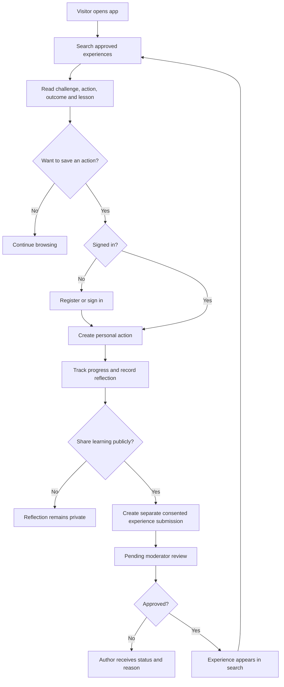
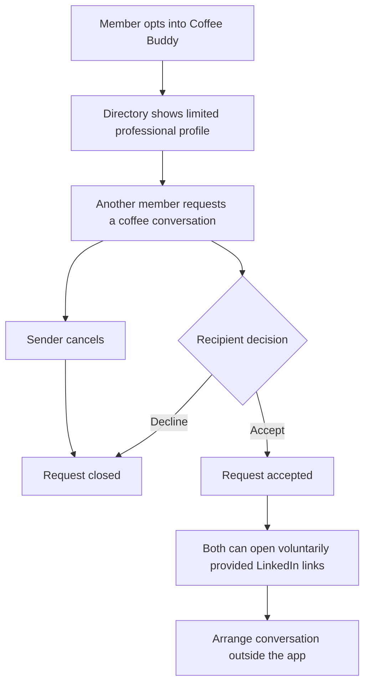
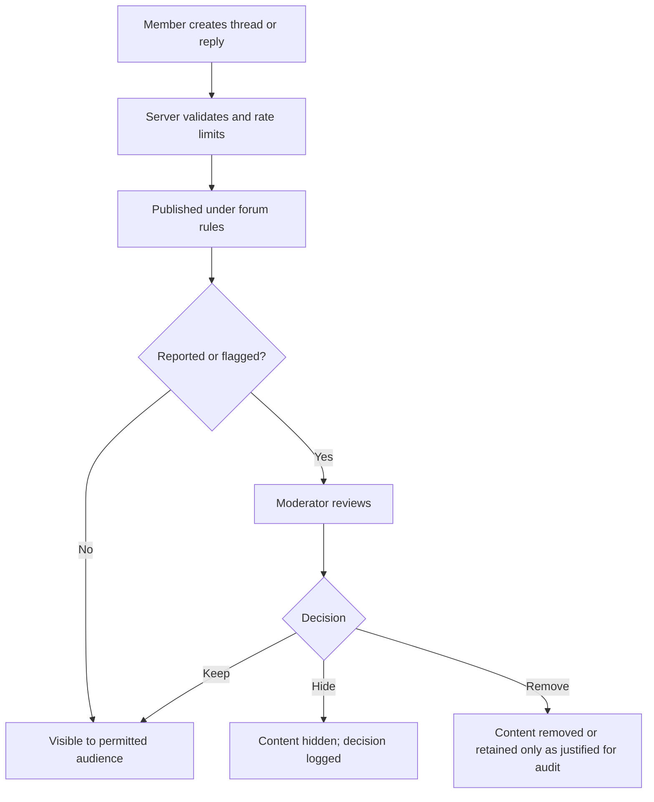
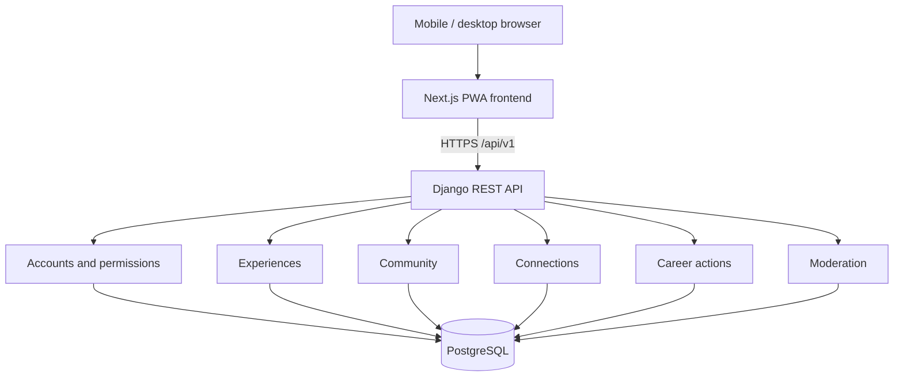
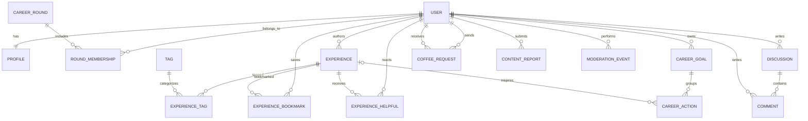

# Career Club Connect — Product & Engineering Master Specification

**Document ID:** CCC-SPEC-001  
**Version:** 1.0 — balanced MVP planning baseline  
**Date:** 14 October 2026  
**Status:** Proposed design baseline; not implemented; organizer validation and technical spikes outstanding  
**Target demonstration:** 6 November 2026  
**Product owner:** Project team / student developer  
**Audience:** Career Club teammates, pilot stakeholders, developers, reviewers, prospective employers

> **Truth in demos:** All seed profiles, stories, rounds, conversations and outcomes are fictional. This application is an independent project concept, not an official City of Espoo service. No real alumni contact lists or City data are assumed.

## 0. Document authority and change policy

This file is the initial single source of truth. `docs/DECISIONS.md`, `docs/CURRENT_STATE.md`, `docs/CHANGELOG.md`, and the issue board will be created when implementation begins. If code differs from this specification, raise an issue and either correct the code or approve a documented change. Do not silently drift.

**Requirement labels:** `MUST` = acceptance gate for balanced MVP; `SHOULD` = desirable if schedule permits; `LATER` = explicitly out of scope. **Validation labels:** `DECIDED` = team planning choice; `ASSUMPTION` = not verified with Career Club; `EXTERNAL` = requires organizer/provider approval.

## 1. Product vision, problem, and boundaries

**One-line pitch:** Career Club Connect helps current and future Career Club participants learn from previous experiences, discuss practical career challenges, request professional coffee conversations, and turn useful advice into actions.

**Hypothesis, not a verified fact:** Valuable career knowledge may be fragmented across rounds and difficult for later participants to retrieve or apply. Validate with coordinator and 3–5 current participants. Career Club already has networking/alumni activities; the product complements rather than replaces them.

**Who benefits:**
- **Visitor:** Browse public, approved, clearly labeled experiences and limited discussion previews.
- **Member:** Profile, experiences, forum participation, private actions, optional Coffee Buddy.
- **Contributor/alumnus:** Same member role, may share experiences and opt into connections.
- **Moderator:** Review/approve/reject/hide content and handle reports; no access to private action journals by default.
- **Administrator:** Manage accounts, role assignments, configuration and operational health; access to personal data only for legitimate administrative purposes.

**Not goals:** employment guarantees, an official Espoo service, a LinkedIn replacement, an unrestricted public social network, automatic alumni identity verification, scraping social networks, AI-generated career advice, real-time chat, or mobile app store publication.

**Success criteria for demo:** A complete working browser journey using persistent demo records: browse/search → view story → save action → update/reflection → contribute story → moderator approval → public appearance; additionally a forum thread/reply and Coffee Buddy request/decision. No mock buttons in claimed complete flows.

**Pilot validation targets (not achievements):** 5–10 voluntary testers; at least 5 feedback interviews/surveys; measure task completion and perceived usefulness. Synthetic usage metrics are never represented as real adoption.

## 2. MVP priorities and explicit cuts

| Priority | Feature | Definition of done |
|---|---|---|
| P0 | Authentication and role permissions | Login/logout, registration, password reset if feasible, private data isolation, backend authorization tests |
| P0 | Profiles | Display name, profession, interests, optional round and LinkedIn; privacy settings; initials avatar |
| P0 | Experiences | Create draft/submit, approve/reject, list/detail, search/filter, helpful reaction, bookmark |
| P0 | Career Actions | Create from story or manually, statuses, target date, private reflection, owner-only access |
| P0 | Moderator tools | Review queue, decision reason, report resolution, audit trail |
| P0 | Responsive UI | Approved visual tokens, 360px+ mobile, tablet, desktop, keyboard navigation |
| P0 | Demo seed | Reproducible deterministic fictional content, separate demo environment |
| P0 | Deployment/testing | HTTPS, migrations, backups, smoke tests, CI |
| P1 | Forum | Threads, replies, helpful votes, report, moderator hide |
| P1 | Coffee Buddy | Opt-in, directory/filter, request, accept/decline/cancel; no internal messaging |
| P1 | PWA | Manifest, icons, installability, safe caching (no caching private responses) |
| LATER | Career Pulse polls, notifications, activity feed, event directory, badges, AI, chat, calendar scheduling, photo uploads | Not promised for 6 November |

**Scope protection:** If P0 slips, cut P1. Do not keep broken P1 pages visible in production. A small fully tested social feature is preferable to a fake full-featured social network.

## 3. User journeys and flowcharts

### 3.1 Main value loop



**Privacy invariant:** A private reflection is never published automatically. Public sharing creates a separately reviewed contribution.

### 3.2 Coffee Buddy



**Safety:** No phone numbers, no internal chat, no public contact email. No guarantee of response. Requests are rate-limited and block/report controls are planned; minimum block/report protection is required before a real-user pilot.

### 3.3 Forum moderation



## 4. Mobile-first information architecture

**Primary mobile navigation (maximum five destinations):** Home, Explore, Community, Actions, Profile. Coffee Buddy is a prominent home shortcut and a subpage under Explore; moderation is role-gated under Profile/administration. Desktop uses persistent left sidebar: Home, Experiences, Community, Coffee Buddy, My Actions, Profile, plus Moderator if authorized.

**Navigation principles:** persistent visible page title, back navigation, search in context, never more than one floating primary action per screen, responsive tables become cards, sticky bottom nav only where it does not obscure controls. Desktop maximum content width ~1200–1280px; mobile designed at 360/390/430px and tested at 320px for critical overflow.

### 4.1 Full screen inventory and states

| ID | Screen / route concept | Main UI and interactions | Empty / loading / error / success states |
|---|---|---|---|
| S01 | Landing `/` | Product explanation, explore, sign-in, demo notice | Skeleton/hero fallback; clear independent-project disclaimer |
| S02 | Register `/register` | Email, password, display name, terms, validation | Field errors, duplicate email, pending, success |
| S03 | Login `/login` | Email/password, sign-in, forgot password | Invalid credentials, loading, lock/rate limit |
| S04 | Onboarding `/onboarding` | Profession, interests, optional round, optional LinkedIn, avatar initials | Skip optional fields, save error, completed |
| S05 | Home `/home` | Welcome, relevant experiences, quick links, action summary, latest discussions | No personalized content, skeleton, API error |
| S06 | Experiences `/experiences` | Search, tags, profession, round, sort, card list, pagination | No results, clear filters, loading, retry |
| S07 | Experience detail `/experiences/[id]` | Challenge/action/outcome/lesson, author summary, LinkedIn if opted-in, helpful, bookmark, save action, report | Deleted/hidden/not found, action confirmation |
| S08 | Submit experience `/experiences/new` | Structured form, privacy choice, preview, submit | Draft/validation, pending moderation, submission confirmation |
| S09 | Edit own experience `/experiences/[id]/edit` | Edit own draft/rejected submission, resubmit | Conflict/unauthorized, save confirmation |
| S10 | Community `/community` | Search threads, topics, recent/helpful sort, create thread | Empty topics, loading, error |
| S11 | Thread `/community/[id]` | Full post, comments, helpful vote, reply, report | No replies, deleted thread, optimistic-state rollback |
| S12 | Create thread `/community/new` | Title, body, topic, preview, submit | Validation, duplicate submission, success |
| S13 | Coffee Buddy `/coffee` | Opt-in toggle, searchable opted-in directory, interests/profession filters | No opt-ins, request errors, own profile excluded |
| S14 | Coffee profile `/coffee/[id]` | Limited professional summary, optional LinkedIn, request button | Private/unavailable, request sent, already requested |
| S15 | Coffee requests `/coffee/requests` | Incoming/outgoing tabs, accept/decline/cancel | No requests, state conflict, status updates |
| S16 | My Actions `/actions` | Goal summary, status filters, action list, create action | First-action empty state, loading, retry |
| S17 | Action detail/edit `/actions/[id]` | Title, linked experience, status, date, private reflection | Not found/forbidden, autosave avoided, save confirmation |
| S18 | Profile `/profile` | Avatar, display name, profession, interests, round, optional LinkedIn, contributions | Profile incomplete, edit prompt |
| S19 | Profile settings `/settings` | Visibility, Coffee opt-in, password/account controls, data request | Confirmations, deletion warnings, errors |
| S20 | Public member profile `/members/[id]` | Limited consented fields, public contributions, optional LinkedIn | Private profile, unavailable |
| S21 | Moderation `/moderation` | Pending experiences, reports, approve/reject/hide with reason | Empty queue, audit confirmation, forbidden |
| S22 | Privacy/terms `/privacy`, `/terms` | Clear controller/contact, purpose, rights, retention, external links | Version/date, accessible reading |
| S23 | 404/403/offline | Helpful message and recovery navigation | No fabricated offline submission success |
| S24 | Component showcase (development only) | Buttons, forms, cards, states, breakpoints | Not publicly indexed; developer QA |

**Route names are design proposals**; API route versioning and frontend routes will be locked together before implementation.

### 4.2 Component state contract

Every interactive component must define: default, hover (pointer), focus-visible (keyboard), active/selected, disabled, loading, validation error, success feedback, and empty/no-data behavior where applicable. Async mutations disable repeat submission, handle server rejection, and never claim success before persistence. Modals trap focus, Escape closes when safe, and destructive operations request confirmation.

### 4.3 Mobile details

- Minimum touch target approximately 44×44 CSS px where feasible; avoid tiny icons as sole affordances.
- Bottom navigation remains visible on main screens; hide or adapt when virtual keyboard opens.
- Forms use single-column layout, visible labels, appropriate input types, validation near the field.
- Cards use predictable hierarchy: topic/round → title → excerpt → actions.
- Avoid horizontal scrolling except intentional chip carousels; check 320–430px widths.
- LinkedIn opens external HTTPS URL with safe target handling; optional, never required.
- Accessible contrast, visible focus, semantic headings, meaningful error text, reduced-motion support.

### 4.4 Desktop details

- Sidebar with active state; top bar for contextual search/account controls.
- Experiences use filter sidebar + result list; details use readable central column + action panel.
- Community uses thread list + topic filters; no infinite feed requirement.
- Coffee directory uses cards with responsive grid; requests have clear status chips.
- Actions use list and detail panel, not an oversized dashboard.

## 5. Design system baseline

**Direction:** Nordic-inspired, clean, credible, professional; white/light neutral surfaces, navy text, restrained blue primary and teal accents. No random colors per module. Match the approved concept's overall structure, not its image-generation artifacts.

**Suggested tokens (subject to visual approval):**
- Brand navy `#102B4E`; primary blue `#1769E0`; teal accent `#0D9488`; text `#17253B`; muted text `#5C6B7C`; border `#DCE4ED`; surface `#FFFFFF`; page `#F6F9FC`; danger `#B42318`.
- Spacing: 4px base scale; card radius 12–16px; inputs/buttons consistent heights.
- Typography: accessible sans-serif (e.g. Inter or system sans), base 16px; responsive heading hierarchy.
- Components: AppShell, MobileTabBar, DesktopSidebar, Button, TextField, Select, Textarea, Tag, Card, ExperienceCard, MemberCard, DiscussionCard, ActionCard, EmptyState, Skeleton, Toast, ConfirmDialog, ReportDialog, AvatarInitials, StatusChip.
- Use shadcn/ui primitives with a **central token file**, not ad-hoc page-specific styles.
- Theme: ship polished light theme first; dark theme later.

**Visual QA checklist:** Compare all screens against approved wireframes at 390px and 1440px; check contrast, long names, empty lists, large text zoom, keyboard, and slow loading. Changes to shared components require regression screenshots of affected pages.

## 6. Technology architecture and rationale

**Recommended:** Next.js (React) + TypeScript + Tailwind CSS + shadcn/ui frontend; Django + Django REST Framework backend; PostgreSQL database; OpenAPI generated contract; pytest and Playwright; GitHub Actions; managed HTTPS hosting. One monorepo, one modular backend, one primary database per environment.

**Why:** TypeScript catches UI contract errors; Next.js supports professional responsive UI; Django provides mature auth/admin/moderation; PostgreSQL enforces relational integrity. Trade-off: two runtimes, more deployment/auth complexity than a single Django app. Reassess if a first-week authentication/deployment spike fails.



**Auth boundary:** Prefer same-origin `/api/v1` reverse proxy to Django with HttpOnly Secure SameSite session cookie, CSRF protection on writes, and server-side permission checks. A frontend and backend on unrelated domains complicates cookie/session security; this is a deployment acceptance gate. Do not store long-lived auth secrets in localStorage.

**Backend modules:** `accounts`, `rounds`, `experiences`, `community`, `connections`, `actions`, `moderation`, `common`. Modules may reference each other via explicit service functions; avoid circular imports and cross-module model mutation in views.

**Scale plan:** pagination and indexes from day one; use select_related/prefetch_related; full-text search via PostgreSQL where needed; rate limits; managed backups. Add queues, caching, object storage or search engines only when justified by measured demand. No microservices for MVP.

## 7. Data model and relationships

### 7.1 Conceptual ERD



### 7.2 Table-level specification

| Entity | Essential fields | Constraints and ownership |
|---|---|---|
| `users` | id UUID, email, password hash, role, active, joined_at | Unique normalized email; role changes admin-only |
| `profiles` | user_id, display_name, profession, bio, interests, linkedin_url, visibility, coffee_opt_in, avatar_style | One-to-one; LinkedIn HTTPS hostname allowlist; no phone |
| `career_rounds` | id, label, approximate year optional, active | Round 1–12 seeded as **illustrative labels**, not verified roster |
| `round_memberships` | user_id, round_id, claimed_role, verification_status | Unique `(user_id, round_id)`; demo unverified |
| `experiences` | id, author_id, title, field, challenge, actions_taken, outcome, lesson, publication_name_choice, status, submitted_at, published_at | Draft/pending/approved/rejected/hidden; moderation-only publish |
| `tags`, `experience_tags` | tag label; experience_id, tag_id | Unique tag slug and pair |
| `experience_bookmarks` | user_id, experience_id, created_at | Unique pair; owner-only list |
| `experience_helpful` | user_id, experience_id | Unique pair; one helpful mark per user |
| `career_goals` | id, owner_id, title, target_date, status | Owner-only |
| `career_actions` | id, owner_id, goal_id nullable, source_experience_id nullable, title, status, target_date, reflection, completed_at | Owner-only; source must be approved if publicly visible |
| `discussions` | id, author_id, title, body, topic, status, created_at | Edit-own within policy; moderator can hide |
| `comments` | id, discussion_id, author_id, body, parent_id optional, status | MVP flat comments recommended; avoid nested reply complexity |
| `discussion_helpful`, `comment_helpful` | user_id, target_id | Unique pair; no downvotes |
| `coffee_requests` | id, sender_id, recipient_id, note optional, status, created_at, responded_at | No self-requests; recipient opted in; unique active request pair |
| `content_reports` | id, reporter_id, content_type, object_id, reason, status | Reporter identity private; moderator access |
| `moderation_events` | id, moderator_id, target_type/id, decision, reason, timestamp | Append-only audit; no unnecessary sensitive content |
| `privacy_consents` | id, user_id, purpose, notice_version, granted_at, withdrawn_at | Separate optional publication/visibility decisions; not blanket consent |

**Implementation note:** A generic `content_type/object_id` report relation is flexible but weakens referential integrity. Before implementation choose either Django ContentTypes with rigorous validation or explicit report targets; document the trade-off in an ADR.

### 7.3 Invariants

- All IDs are non-sequential UUIDs in public APIs; UUIDs do not replace authorization.
- Private career goals/actions are visible only to their owner; moderators do not get journal access by default.
- Only approved experiences appear to visitors; pending drafts visible to author and authorized moderator.
- LinkedIn is optional and cannot be used as proof of identity.
- Coffee requests only to opted-in, non-blocked recipients; enforce request caps.
- Author cannot approve own experience merely by changing a status in the API.
- Public display name choice is respected even if a profile contains a real name.
- Hard deletion/anonymization behavior is specified per entity before real pilot; audit retention must be justified.
- Production and demo databases are separate; no copying synthetic users into real pilot.

## 8. API boundary and representative contracts

**Prefix:** `/api/v1/`. All write endpoints use CSRF-protected authenticated sessions unless explicitly public registration. Response envelopes and pagination are documented in OpenAPI; frontend types generated from that contract.

| Method | Endpoint | Access | Result |
|---|---|---|---|
| POST | `/auth/register` | Guest | Create account; validation |
| POST | `/auth/login` | Guest | Start secure session |
| POST | `/auth/logout` | Member | End session |
| GET/PATCH | `/me/profile` | Member | Read/update own profile |
| GET | `/experiences?search=&field=&round=&page=` | Public | Paginated approved experiences |
| GET | `/experiences/{id}` | Public if approved | Experience detail |
| POST | `/experiences` | Member | Draft or pending submission |
| PATCH | `/experiences/{id}` | Author in allowed state | Edit draft/rejected |
| POST | `/experiences/{id}/submit` | Author | Pending review |
| POST/DELETE | `/experiences/{id}/bookmark` | Member | Save/unsave |
| POST/DELETE | `/experiences/{id}/helpful` | Member | Helpful/unhelpful |
| GET/POST | `/goals` | Member | Own goals |
| GET/POST | `/actions` | Member | Own actions |
| GET/PATCH/DELETE | `/actions/{id}` | Owner | Own action management |
| GET/POST | `/discussions` | Public read / member write | Forum list/create |
| GET | `/discussions/{id}` | Public if visible | Thread and comments |
| POST | `/discussions/{id}/comments` | Member | Comment |
| GET | `/coffee/profiles` | Member | Opted-in limited profiles |
| GET/POST | `/coffee/requests` | Member | Own requests / send |
| POST | `/coffee/requests/{id}/accept` | Recipient | Accept |
| POST | `/coffee/requests/{id}/decline` | Recipient | Decline |
| POST | `/coffee/requests/{id}/cancel` | Sender | Cancel |
| POST | `/reports` | Member | Report content |
| GET | `/moderation/queue` | Moderator | Pending items/reports |
| POST | `/moderation/experiences/{id}/approve` | Moderator | Publish + audit |
| POST | `/moderation/experiences/{id}/reject` | Moderator | Reject with reason + audit |

**Contract example — submit experience:**

```json
{
  "title": "Preparing for a technical interview",
  "career_field": "IT",
  "challenge": "I did not know what interviewers expected.",
  "actions_taken": "I practised explaining two portfolio projects.",
  "outcome": "I became more confident explaining my work.",
  "lesson": "Prepare concrete examples.",
  "round_id": null,
  "publication_name_choice": "anonymous",
  "tags": ["interviews", "portfolio"]
}
```

**Example response:** `201 Created` with `status: "pending"`; **never** auto-publish. Server validates lengths, tags, ownership, publication choice and rate limits.

**Errors:** `400` malformed input; `401` not signed in; `403` no permission; `404` not found or hidden; `409` invalid state transition/duplicate active request; `429` rate-limited; `5xx` logged server failure with safe client message. API must not leak private records through errors or search.

## 9. Permissions matrix

Legend: `R` read, `C` create, `E` edit, `M` moderate, `—` none. Public experiences only means **approved** content.

| Resource | Visitor | Member | Author/owner | Moderator | Admin |
|---|---|---|---|---|---|
| Approved experiences | R | R | R | R | R |
| Pending own experience | — | — | R/E | R/M | R/M |
| Create experience | — | C | C | C | C |
| Approve/reject experience | — | — | — | M | M |
| Public discussions | R (configured) | R/C | R/E own | R/M | R/M |
| Comments | R (configured) | C | E own | M | M |
| Own career actions/reflections | — | — | R/C/E | — | Administrative only with exceptional documented need |
| Other member's private actions | — | — | — | — | — by default |
| Coffee directory | — | R if eligible | R | R for safety | R |
| Coffee requests | — | Send own | Manage own incoming/outgoing | Investigate reported cases only | Controlled operational access |
| Account settings | — | — | Own only | — | Limited admin |
| Moderation queue | — | — | — | R/M | R/M |

**Object-level checks are mandatory on every detail/write endpoint**, not just page visibility.

## 10. Synthetic data plan and photo strategy

**Seed target:** 60 fictional profiles across illustrative Round 1–12 labels (approximately 5 per round), 45 experiences, 35 threads, 100 comments, 25 Coffee Buddy opt-ins, 20 requests, 80 actions, 15 pending submissions, 10 reports. Counts can be tuned; avoid artificial uniformity.

**Distribution:** IT, engineering, healthcare, business, logistics, hospitality, marketing, education, public services; a mix of successful, unsuccessful, uncertain and ongoing career outcomes. Varied text lengths, Finnish workplace contexts, different interests and action states.

**Generator:** `python manage.py seed_demo --seed 20261014` (planned command). Idempotent or explicit reset, fixed randomness, no external scraping, no actual alumni identities, no real contact details. Demo login credentials must be provisioned securely, not publicly hardcoded in production.

**Photo policy:** Default deterministic initials avatars; optional clearly illustrated fictional portraits, never photos misrepresented as real alumni. Real pilot photo upload only after storage, malware/type/size validation, moderation, consent/notice, and deletion policy are ready. No need for photos in MVP. Fictional LinkedIn links should be disabled or use clearly labeled demo behavior, never point to an unrelated real person.

**Demo banner:** Persistent on synthetic-data environment: `DEMO — Fictional profiles and experiences. Not an official City of Espoo service.` Demo analytics must be labeled simulated.

**Migration to real pilot:** Deploy same version of code against a new empty database; seed only neutral configuration/taxonomy/round labels after verification; invite voluntary users; do not convert fake accounts to real ones or silently republish fake stories.

## 11. GDPR, safety, and operational responsibilities

**Privacy by design:** Data minimization; purpose-specific collection; private-by-default journals; opt-in Coffee directory; optional LinkedIn; avoid phone numbers; clear public/private boundary; content report tools; least privilege; encrypted transport; backups; retention/deletion procedures.

**Before accepting real users:** Identify actual controller and processors; document lawful basis for each processing purpose (not automatically consent for everything); publish controller identity/contact and privacy notice; sign appropriate processor agreements; check hosting locations/international transfers; define retention and deletion schedules; establish rights handling (access, rectification, erasure where applicable, portability where applicable, objection); secure admin access; incident response; assess whether DPIA is required. Obtain organizer permission before implying official association or using protected branding.

**Publication consent:** A user choosing to publish an experience must see exactly which fields will become public, including display name/round if selected. Revocation and removal workflow required. Public comments can reveal personal information; reporting and moderation necessary.

**Security controls:** password hashing via Django, session rotation, secure/HttpOnly/SameSite cookies, CSRF, input validation, safe HTML rendering, ORM queries, rate limits, content length limits, no sensitive logs, environment secrets, dependency checks, backups and restore rehearsal. Never trust a frontend-only permission check. Prevent stored XSS in forum content; render plaintext or a safely sanitized limited Markdown subset.

**Coffee Buddy safety:** Users opt in; no precise location, no phone or email directory; accept/decline; cancellation; blocking/reporting before real pilot; anti-spam caps; clear advice to arrange meetings safely through their chosen external channels.

**Synthetic-only demo:** GDPR concerns still apply to actual testers' account data if they sign up; safest public demonstration uses explicitly fictional seeded accounts and a controlled environment, with real testers providing separate voluntary feedback.

## 12. Testing and quality gates

### 12.1 Test pyramid

- **Unit:** model state transitions, serializers, validators, LinkedIn URL validation, helper functions.
- **API integration:** auth/CSRF, object permissions, moderation, search, pagination, unique reactions, Coffee request transitions.
- **Browser E2E:** mobile and desktop complete journey, login, search, save action, private reflection, story submission/approval, forum reply, Coffee accept/decline.
- **Visual/accessibility:** responsive screenshots at 390px and 1440px, keyboard/focus, labels, contrast, 200% zoom, axe where feasible.
- **Security:** anonymous access attempts, IDOR attempts, cross-user edits, CSRF, XSS payloads, rate limits, sensitive data in API responses.
- **Deployment smoke:** health endpoint, DB connection, migrations, static assets, HTTPS, auth cookies, public browse.

### 12.2 Critical acceptance scenarios

| Test ID | Scenario | Expected |
|---|---|---|
| T01 | Visitor searches approved experiences | Results filtered/paginated; pending hidden |
| T02 | Member submits story | Stored pending, not public |
| T03 | Moderator approves story | Becomes public, audit event recorded |
| T04 | Member edits another user's action ID | 403/404; no data exposure |
| T05 | Member saves story-derived action | Action persists with correct owner/link |
| T06 | Member adds reflection | Remains private |
| T07 | Member creates thread and reply | Persisted and visible under forum rules |
| T08 | User votes helpful twice | One effective vote, no duplicate count |
| T09 | Coffee request to non-opted-in user | Rejected |
| T10 | Recipient accepts own incoming request | Accepted; sender cannot accept |
| T11 | Mobile at 390px | No horizontal overflow, navigation usable |
| T12 | Demo reset | Deterministic fictional data, no real data touched |
| T13 | LinkedIn URL invalid or unsafe | Rejected or not rendered as clickable link |
| T14 | Hidden content requested directly | Not publicly accessible |

**CI merge gate:** backend unit/integration tests + frontend lint/typecheck + build + selected E2E smoke tests. Release gate adds complete E2E suite, responsive QA, migration check, backups, and security review.

## 13. DevOps, environments, and deployment

**Environments:** `local` (Docker Compose optional), `demo/staging` (synthetic), `pilot/production` (future real users only). Separate PostgreSQL databases, credentials, domains/config and backups. Demo data must never be seeded into pilot.

**Repository plan:**

```text
career-club-connect/
  README.md
  docs/
    PROJECT_MASTER.md
    DECISIONS.md
    CURRENT_STATE.md
    CHANGELOG.md
    PRODUCT_SPEC.md
    DESIGN_SYSTEM.md
    SCREEN_SPECS.md
    ARCHITECTURE.md
    DATABASE.md
    API.md
    PRIVACY_SECURITY.md
    TEST_PLAN.md
    DEPLOYMENT.md
    LEARNING_NOTES.md
  frontend/          # Next.js TypeScript
  backend/           # Django + DRF
  infrastructure/    # deploy/proxy/compose config
  tests/             # cross-service E2E tests
  .github/workflows/ # CI
```

**Hosting selection criteria:** same-origin API routing, HTTPS, managed PostgreSQL backups, predictable monthly cost, secrets management, EU-region options where available, deployment logs, rollback. Do not choose vendor solely on free tier. Verify actual provider pricing/regions/limits at deployment time.

**Release process:** feature branch → issue → implementation → tests → pull request/self-review → CI → staging deploy → smoke tests → release tag → production/demo deployment → monitor. Store `.env.example`, never commit real `.env` or passwords.

**Observability:** structured server logs without personal content, error reporting with data minimization, `/health` endpoint, DB backup alerts, basic uptime monitoring; no invasive tracking scripts by default.

## 14. Feature change-control and architecture decision records

**Problem to prevent:** unplanned features changing UI, database and APIs inconsistently.

**Every change request includes:** user problem; affected screens/modules; data model migration; API additions/changes; permission impact; GDPR/safety impact; test updates; responsive design impact; effort; priority; rollback; acceptance criteria.

**Rules:**
1. Do not edit production code from a chat request until change scope is recorded.
2. Extend shared components/tokens; avoid one-off visual variants.
3. Version API; additive backward-compatible changes preferred.
4. Database migrations are reviewed and tested with representative data.
5. Feature flags or route guards hide incomplete modules.
6. New module must not access another module's private records without an explicit service/permission boundary.
7. Update docs, tests and `CURRENT_STATE.md` in the same change.
8. Freeze new features 3 November; critical fixes only until presentation.

**ADR template:** Context → Decision → Alternatives → Consequences → Review date. First ADRs: ADR-001 Next.js+DRF, ADR-002 session authentication and same-origin proxy, ADR-003 synthetic/real environment separation, ADR-004 flat forum comments, ADR-005 no real-time chat.

## 15. Portfolio learning and explainability

For each implemented feature create `LEARNING_NOTES.md` entries covering: (a) user problem, (b) data path from click to database, (c) relevant files/functions, (d) security boundaries, (e) alternatives rejected, (f) tests, (g) a bug encountered and fix, (h) scaling consideration.

**Interview stories to develop:**
- Why a modular monolith instead of microservices.
- How DRF object-level permissions prevent IDOR.
- How a pending experience becomes public only after moderation.
- How Next.js types stay aligned with OpenAPI.
- How PostgreSQL constraints prevent duplicate helpful votes/active requests.
- How privacy defaults protect journals and Coffee Buddy profiles.
- How seed data enables repeatable demos without fabricating adoption.
- How CI and E2E tests prevent regressions.
- How a feature request is evaluated before touching code.

**Git commits:** Meaningful, issue-linked commits, not artificial volume. Examples: `docs: approve mobile screen map`, `feat(experiences): implement pending submission`, `test(auth): block cross-user access`, `fix(ui): prevent mobile card overflow`. Use GitHub Projects columns Backlog, Ready, In Progress, Review, Done, Blocked; issues have definition of done.

## 16. Timeline and hard gates

| Dates | Milestone | Acceptance gate |
|---|---|---|
| 14–17 Oct | Specification, mobile wireframes, architecture, hosting/auth spike | Team signs off scope; main screens specified; spike proves login/API path |
| 18–23 Oct | Core accounts/profiles/experiences/moderation/seed | End-to-end experience publication works |
| 24–29 Oct | Actions, forum, basic Coffee Buddy | Each P1 feature has tests; cut if P0 not stable |
| 30 Oct–2 Nov | Deployment, mobile QA, privacy/security review | Public demo URL works; no known critical defects |
| 3–5 Nov | Feature freeze, rehearsal, screenshots/video fallback | 5-minute demo reproducible; docs current |
| 6 Nov | Presentation | Clearly distinguish synthetic content from real pilot evidence |

**Capacity warning:** Full social-media-grade functionality is not feasible in three weeks with rigorous quality. Balanced MVP means intentionally limited but working forum and Coffee Buddy, not complete Reddit/LinkedIn clones.

## 17. Demo presentation script (five-minute outline)

- **0:00–0:40:** Problem across Career Club rounds; explicitly say hypothesis and independent prototype.
- **0:40–1:25:** Mobile experience search and useful story; show profession filters.
- **1:25–2:10:** Save action and mark progress; explain privacy.
- **2:10–2:55:** Forum discussion and helpful reply.
- **2:55–3:35:** Coffee Buddy opt-in and request; optional LinkedIn, no phone exposure.
- **3:35–4:25:** Submit experience, switch to moderator, approve, see it in library.
- **4:25–5:00:** Why this complements existing tools; fictional demo disclosure; request voluntary future pilot, no adoption claims.

**Fallback:** Pre-captured screenshots and a local test account if network/hosting fails. Never claim prerecorded interactions are live.

## 18. Outstanding decisions before implementation

1. Confirm coordinator's position on use of the Career Club name/branding and future outreach. Until then, independent-project disclaimer.
2. Verify that structured alumni experience retrieval is an actual unmet need (assumption).
3. Decide whether public browsing includes forum text or only experience library.
4. Decide whether account registration is open to all demo visitors or invite-only for a future pilot.
5. Validate same-origin session authentication and hosting route with a minimal spike.
6. Approve final typography, color tokens and 390px/1440px wireframes.
7. Decide whether forum posts publish immediately with report/moderation or queue first; current proposal is immediate publish with controls.
8. Decide real pilot moderation owner, privacy contact, data retention, and operational budget before collecting real participant content.
9. Confirm whether `Career Club Connect` branding requires permission or should use an explicit independent-project qualifier.
10. Decide how account deletion affects authored public experiences and replies; publish the policy before real users join.

## 19. Definition of ready to code

Do **not** start main implementation until: product scope signed off; route map approved; UI tokens approved; database constraints and state transitions reviewed; API permission rules specified; deployment/auth spike passes; demo data policy and privacy defaults accepted; first GitHub milestone/issues created.

**Final principle:** A feature is finished only when UI, backend, database behavior, permissions, tests, documentation and deployment behavior agree.
