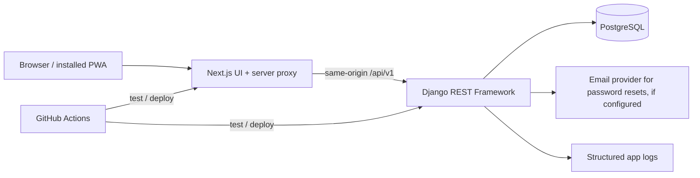
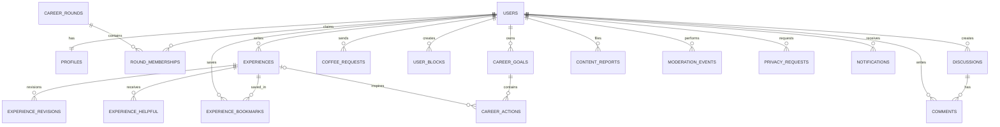

# Career Club Connect — Product Sign-off & Technical Architecture Lock

**ID:** CCC-ARCH-LOCK-001  
**Version:** 1.1 — four owner decisions recorded on 15 October 2026; remaining decisions and technical spike pending  
**Date:** 15 October 2026  
**Target presentation:** 6 November 2026  
**Status:** Planning only. No application code has been created.  
**Inputs reviewed:** `CAREER_CLUB_CONNECT_MASTER_SPEC.md`, `PROJECT_BLUEPRINT.md`, `CAREER_CLUB_CONNECT_DESIGN_AUDIT.md`, and the described 12 mobile/6 desktop visual boards.  
**Authority:** This document becomes binding only after product-owner approval and corresponding updates to the master specification. Illustrative mockups do not create requirements.

> **Truthfulness:** Career Club Connect is an independent prototype. Demo users, Career Club round affiliations, posts, and usage counts are fictional. No official City of Espoo relationship, organizer endorsement, or real alumni participation is implied. The product problem remains a hypothesis to validate.

## 1. Executive decision summary

**One-line product:** A searchable, moderated Career Club experience library that helps people turn advice into private career actions, supported by practical community discussions and opt-in Coffee Buddy requests.

**Primary value loop:** `Experience submitted → moderator review → approved story discovered → career action created → progress/reflection → optional new experience`.

**Two success criteria:** (a) a nontechnical Career Club audience can complete and understand the live demo; (b) a recruiter can inspect a well-tested, documented, deployed full-stack system and understand its engineering trade-offs.

**Architecture recommendation:** One responsive Next.js/TypeScript PWA frontend, Django REST Framework backend, PostgreSQL database, a same-origin API boundary, and a modular monolith with typed API contracts. No microservices, WebSockets, AI, OAuth, internal chat, or native app.

**Sign-off status:** Owner approved D03, the public-read portion of D09, the demo-only portion of D10, and D11. Other D01–D16 items remain proposals unless explicitly approved. No authentication/deployment spike has run and no claim of GDPR compliance is made.

## 2. Product boundary and feature freeze

| Tier | Modules | Demonstrable acceptance |
|---|---|---|
| P0 — must ship | Auth/onboarding/private-by-default profile; approved experience library and search; story draft/preview/submission/moderation; bookmarks/helpful; personal goals/actions/reflections; moderation audit/report intake; deployment/seed/tests | Guest reads approved story; member saves it and creates a private action; contributor submits; moderator requests changes; contributor resubmits; moderator approves; story becomes searchable |
| P1 — target if P0 green | Flat community forum; Coffee Buddy opt-in directory/request lifecycle; basic PWA shell | Members post/reply/report; send/accept/decline/cancel Coffee request; no chat or contact disclosure |
| P1 conditional (CR-001) | Database-backed in-app notifications | Recipient-only inbox, read/unread, authorized deep links; hide completely if unfinished |
| Later | Following, direct messages, event listings, matching/AI, badges, polls, image upload, calendar booking, OAuth, push notifications, realtime, offline writes | No active buttons or misleading claims in MVP |

**Cut order:** notifications → installability polish → Coffee Buddy → forum. Never cut authorization, approved-only publication, core action loop, seed integrity, or production verification to retain extra features.

## 3. Decision register — partial owner sign-off recorded

| ID | Proposed decision | Reason / caveat | Status |
|---|---|---|---|
| D01 | Mobile bottom tabs: Home / Explore / Community / Actions / Profile | Coffee Buddy reachable via Explore + Home; desktop sidebar may list it directly | APPROVAL NEEDED |
| D02 | Nordic blue-white design tokens from audit §5, centrally managed | Verify contrast in real UI | APPROVAL NEEDED |
| D03 | Notifications conditional P1, not a deadline blocker | Approved scope change CR-001; only ship if P0 stable | **APPROVED — 15 Oct 2026** |
| D04 | Forum authors named, no anonymous forum posting | Reduces abuse/complexity; forum visible immediately with reporting/moderator hide | APPROVAL NEEDED |
| D05 | Experience author can publish anonymously to other members; moderator retains internal author ID | No public attribution leakage in API/search/bookmarks/notifications | APPROVAL NEEDED |
| D06 | Demo avatars = initials/illustrations; no real participant photos | Avoid fictional identity confusion | APPROVAL NEEDED |
| D07 | LinkedIn URL optional, user supplied, shown only with visibility permission; disabled for synthetic accounts | No LinkedIn API or invented real links | APPROVAL NEEDED |
| D08 | Round membership self-reported until evidence-based verification by authorized admin | No invented verified alumni | APPROVAL NEEDED |
| D09 | **Public browsing:** approved experience library + read-only visible forum threads; people directory requires sign-in | Public-read forum portion approved; people directory sign-in rule remains proposed | **PARTIALLY APPROVED — 15 Oct 2026** |
| D10 | **Demo registration:** public sign-up with safeguards; **pilot registration:** separate policy to be chosen with organizer | Demo sign-up approved; email verification, rate limits, spam defense, no automatic membership verification; pilot policy open | **DEMO APPROVED — 15 Oct 2026; PILOT OPEN** |
| D11 | Editing an approved experience creates a pending revision while last approved version stays public | New revision requires moderation; existing approved version stays visible unless hidden/deleted | **APPROVED — 15 Oct 2026** |
| D12 | **Deletion:** unpublish public contributions on verified account-deletion request, then remove/anonymize as policy allows; moderation audit retained minimally with documented purpose/period | Precise retention and legal basis require pilot review; avoid instant-deletion promise | APPROVAL NEEDED |
| D13 | Profile discoverability off, Coffee opt-in off, LinkedIn display off by default | Explicit choice, not bundled consent | APPROVAL NEEDED |
| D14 | Coffee accepted requests disclose **no email/phone automatically**; members can independently choose an optional visible LinkedIn link | No in-app messaging or actual meeting scheduler | APPROVAL NEEDED |
| D15 | No photo upload in demo/MVP; initials fallback | Lower storage, safety and moderation risk | APPROVAL NEEDED |
| D16 | Export: authenticated JSON export of own supported data, with secure asynchronous request path if needed | No pretend export/download control | APPROVAL NEEDED |

**Owner-approved policy detail:** Guests may read published, nonhidden forum threads but cannot post, comment, vote or report without signing in. Public sign-up is for the independent fictional-data demo, not a claim of Career Club membership. Pending revisions are visible to their author and moderators only. In-app notifications remain behind a feature flag and have no critical-path dependency.

**External decisions, not lockable now:** Career Club name/branding permission; whether organizers can introduce voluntary alumni testers; real pilot controller/privacy contact; real data retention schedule; pilot invitation policy; funding and moderation staffing. Keep the demo independent until these are agreed.

## 4. User roles and authorization rules

| Capability | Guest | Member | Moderator | Administrator |
|---|---|---|---|---|
| Read approved, nonhidden experiences | Yes | Yes | Yes | Yes |
| Read visible forum threads | Yes (proposal D09) | Yes | Yes | Yes |
| Search opted-in Coffee profiles | No | Yes | Yes, as ordinary member | Yes, subject to purpose |
| Edit own profile / privacy settings | No | Own only | Own only | Own only by default |
| Write experience / forum / career action | No | Own | Own | Own |
| View private goals/reflections | No | Own only | Own only | Own only (no routine staff access) |
| Read Coffee request note | No | Sender/recipient only | Not routinely | Not routinely |
| Review pending experiences / reports | No | No | Yes | Yes |
| Verify membership / manage roles | No | No | No (unless delegated explicitly) | Yes |
| Export/delete own account | No | Own | Own | Own; staff handles verified requests via process |

**Enforcement:** Django object-level authorization on every read and mutation, not just hidden UI. Use generic 404 for undiscoverable objects, 403 for permitted-to-know but unauthorized operations. Querysets must filter by publication/visibility before pagination and counting. Report metadata, audit notes, private author IDs, email, and private reflections never enter public serializers.

## 5. Navigation and screen mapping

**Mobile:** Home | Explore | Community | Actions | Profile. Top bar: contextual search and conditional bell. Coffee Buddy = Explore > People, plus Home shortcut. Settings = Profile > Settings. Moderation = authorized Profile menu. 

**Desktop:** Persistent sidebar Home, Explore, Community, Coffee Buddy, My Actions, Profile; utility Settings and role-gated Moderation. Top bar: global search, conditional notifications, account menu. Tablet: collapsible rail; same routes and permissions.

**Routes:** `/`, `/register`, `/login`, `/forgot-password`, `/reset-password`, `/onboarding`, `/home`, `/explore`, `/experiences`, `/experiences/[id]`, `/experiences/new`, `/experiences/[id]/edit`, `/community`, `/community/[id]`, `/community/new`, `/coffee`, `/coffee/[id]`, `/coffee/requests`, `/actions`, `/actions/[id]`, `/profile`, `/members/[id]`, `/settings`, `/notifications` (conditional), `/moderation`, `/moderation/experiences/[id]`, `/moderation/reports`, `/moderation/members`, `/privacy`, `/terms`, `/help`.

**UI behavior:** responsive layout only, not a separate mobile app. All screens use loading/empty/validation/error/forbidden/success states; navigation and action names are consistent across devices. Never show an unimplemented button as though functional.

## 6. Locked visual system proposal

| Token | Value | Usage |
|---|---|---|
| `brand-navy` | `#102B4E` | Brand/headings |
| `primary` | `#1769E0` | Primary actions and selected nav |
| `primary-hover` | `#1257BD` | Hover |
| `text` | `#17253B` | Main text |
| `muted` | `#5C6B7C` | Secondary text |
| `border` | `#DCE4ED` | Lines/inputs |
| `page` | `#F6F9FC` | App background |
| `surface` | `#FFFFFF` | Cards/dialogs |
| `success` | `#067647` | Completed |
| `danger` | `#B42318` | Errors/destructive |
| `warning` | `#9A6700` | Pending, with text+icon |

Inter/system sans, body 16px, spacing scale 4/8/12/16/24/32/48/64px, card radius 12px, input radius 8px, modal radius 16px. Responsive references 390px/1024px/1440px; test 320px and 200% zoom. Min 44px touch target where feasible. Target WCAG 2.2 AA, **not a certification**. Components: `AppShell`, `TopBar`, `MobileTabBar`, `DesktopSidebar`, `Button`, `Field`, `Select`, `Dialog`, `Toast`, `Avatar`, `ExperienceCard`, `DiscussionCard`, `MemberCard`, `ActionCard`, `FilterPanel`, `StatusBadge`, `EmptyState`, `ErrorState`, `Skeleton`, `ConfirmationDialog`. One theme and one component source; no per-feature copies.

## 7. Architecture: explicit boundaries



- **Frontend:** Next.js App Router, TypeScript strict mode, Tailwind CSS, shadcn/ui (Radix primitives), React Hook Form + Zod for client-side form UX, generated API types from OpenAPI. **Frontend validation is not authorization.**
- **Backend:** Python/Django/DRF, domain-specific Django apps, DRF serializers and permissions, service-layer functions for multi-record transitions, PostgreSQL transactions and migrations. API documented with OpenAPI (e.g. drf-spectacular).
- **Database:** PostgreSQL with UUID public IDs, relational foreign keys, unique constraints, indexed filters, explicit state transitions.
- **Authentication proposal:** Django session cookies (`HttpOnly`, `Secure`, appropriate `SameSite`) with CSRF protection. Route browser API requests through a same-origin Next.js proxy; avoid storing access tokens in localStorage. **Must validate cookie forwarding, CSRF, logout and refresh on actual hosts before architecture is final.**
- **Search:** PostgreSQL full-text/trigram as justified; first iteration `icontains`/indexed filters on approved records, pagination and query limits. No Elasticsearch or AI.
- **Async:** No Celery/Redis requirement for MVP. If password reset email/export requires background work, choose bounded synchronous flow or add a job queue only with a documented ADR.
- **Deployment:** two services may be deployed separately behind one public origin/proxy; use managed PostgreSQL, HTTPS, env secrets, migration command, backup/restore and health checks. **Provider and cost not locked until hosting spike.**
- **PWA:** manifest and static assets; do not cache authenticated API responses or private journals; no offline writes.

**Architecture risk gate:** A minimal deployed Next.js → Django `/api/v1/auth/session` → PostgreSQL login/CSRF/logout flow must pass before implementing full modules. If same-origin proxy proves impractical, record ADR with secure alternative; don't silently switch to insecure token storage.

## 8. Database: proposed relational model

### 8.1 Entity definitions and key fields

| Table | Core fields | Constraints / privacy |
|---|---|---|
| `users` | `id UUID PK`, `email`, `password_hash`, `role`, `is_active`, timestamps | unique normalized email; email private; role assignment admin-controlled |
| `profiles` | `user_id PK/FK`, `display_name`, `profession`, `bio`, `city_optional`, `linkedin_url`, `profile_visible`, `linkedin_visible`, `coffee_opt_in`, timestamps | 1:1 user; visibility flags default false; initials avatar derived |
| `career_rounds` | `id`, `round_number`, `label`, `is_demo` | Round labels in demo illustrative, not verified historical claims |
| `round_memberships` | `id`, `user_id`, `round_id`, `claim_status`, `verified_by`, `verified_at` | unique user/round; status self_reported/verified/rejected; evidence never public |
| `tags` | `id`, `slug`, `label`, `type` | unique type+slug |
| `experiences` | `id`, `author_id`, `title`, `field`, `challenge`, `actions_taken`, `outcome`, `lessons`, `anonymous_publicly`, `status`, `submitted_at`, `published_at`, timestamps | author+moderator can read draft; approved visible; moderation required |
| `experience_revisions` | `id`, `experience_id`, `submitted_by`, `content_snapshot`, `status`, timestamps | proposed revision mechanism: last approved version remains visible; moderator only pending revision |
| `experience_tags` | `experience_id`, `tag_id` | unique pair |
| `experience_bookmarks` | `user_id`, `experience_id`, `created_at` | unique pair; owner-only list |
| `experience_helpful` | `user_id`, `experience_id`, `created_at` | unique pair; one vote/user/story |
| `discussions` | `id`, `author_id`, `title`, `body`, `topic_id`, `status`, timestamps | named member; public if visible; moderator hide |
| `comments` | `id`, `discussion_id`, `author_id`, `body`, `status`, timestamps | flat replies, no nested tree |
| `discussion_helpful` / `comment_helpful` | `user_id`, `target_id` | unique pair; no downvote |
| `coffee_requests` | `id`, `sender_id`, `recipient_id`, `message`, `status`, timestamps | sender != recipient; sender/recipient-only; prevent duplicate pending pair; pending/accepted/declined/cancelled |
| `user_blocks` | `blocker_id`, `blocked_id`, `created_at` | unique pair; no self-block; enforce both directions for new requests |
| `career_goals` | `id`, `owner_id`, `title`, `target_date`, timestamps | owner only |
| `career_actions` | `id`, `owner_id`, `goal_id nullable`, `source_experience_id nullable`, `title`, `status`, `target_date`, `reflection`, timestamps | owner only; not_started/in_progress/completed |
| `content_reports` | `id`, `reporter_id`, `target_type`, `target_id`, `reason`, `status`, timestamps | reporter/staff-only; validated target type; no public reports |
| `moderation_events` | `id`, `actor_id`, `target_type`, `target_id`, `action`, `reason`, `created_at` | staff-only audit; append-only policy |
| `privacy_consents` | `id`, `user_id`, `purpose`, `version`, `granted_at`, `withdrawn_at` | opt-in records, no bundled consent |
| `privacy_requests` | `id`, `user_id`, `type`, `status`, `completed_at`, timestamps | export/delete request tracking, restricted |
| `notifications` (conditional) | `id`, `recipient_id`, `type`, `target_type`, `target_id`, `read_at`, `created_at` | recipient only, no hidden author identity |

**Django implementation note:** `users` should be a custom Django user model from migration 0001, not a late swap. `password_hash` is Django's `password` storage field in actual ORM. Fields above are conceptual, not literal migration code. Avoid unrestricted generic foreign keys for reports: validate allowed target types and authorization; explicit nullable FKs are an acceptable simpler alternative.

### 8.2 ERD (logical, not physical schema)



### 8.3 Important invariants

1. Public queries never include draft/pending/rejected/hidden experiences or unapproved revisions.
2. An anonymous public story omits author name/avatar/profile link/LinkedIn/round identity where it would identify the author, across all serializers and search cards. Authorized moderator can see original author for abuse review.
3. Approval/rejection/request-changes are atomic state transitions, with actor/reason audit record created in same transaction; concurrent decisions conflict cleanly.
4. Published story edits create a new revision and **do not overwrite** approved public content until approval.
5. Career action/reflection ownership enforced on queryset and serializer; even administrator cannot casually browse journals.
6. Coffee requests reject self, non-opted-in, blocked, duplicate-active and rate-limited requests. Opt-out stops new requests immediately; pending request handling must be explicit.
7. `round_memberships` default self-reported; only authorized verifier sets verified.
8. User removal/withdrawal affects public content and search promptly; policy for historical discussion context and backup retention requires pilot approval.
9. Public IDs are UUIDs but **UUIDs are not a substitute for authorization**.

## 9. API v1 contracts (proposal)

**Convention:** `/api/v1/...`; JSON request/response; paginated lists `{count,next,previous,results}`; errors `{code,message,fields?}`; authenticated mutations require CSRF; dates ISO 8601; IDs UUID; server-generated status, author and counts; list filtering server-side. Keep URL query state for searches. **This table is an API contract proposal, not an implemented API.**

| Domain | Methods and paths | Who / behavior |
|---|---|---|
| Auth | `POST /auth/register`, `POST /auth/login`, `POST /auth/logout`, `GET /auth/session`, `POST /auth/password-reset/request`, `POST /auth/password-reset/confirm` | Guest/member; secure cookies, throttling, reset tokens; CSRF strategy verified |
| Onboarding | `GET /me`, `PATCH /me/profile`, `GET /rounds`, `POST /me/round-memberships` | Self only; round claim remains self-reported |
| Profiles | `GET /members`, `GET /members/{id}` | Signed-in; only opted-in public fields; filters; blocked/hidden excluded |
| Experiences | `GET /experiences`, `GET /experiences/{id}`, `POST /experiences`, `PATCH /experiences/{id}`, `POST /experiences/{id}/submit` | Public read approved only; owner writes draft; approved edits create revision |
| Experience interaction | `PUT /experiences/{id}/bookmark`, `DELETE /experiences/{id}/bookmark`, `PUT /experiences/{id}/helpful`, `DELETE /experiences/{id}/helpful` | Signed-in; idempotent one-per-user |
| My experiences | `GET /me/experiences`, `GET /me/experiences/{id}` | Owner sees draft/review feedback |
| Forum | `GET /discussions`, `POST /discussions`, `GET /discussions/{id}`, `POST /discussions/{id}/comments`, `PUT/DELETE /discussions/{id}/helpful`, `POST /reports` | Public visible read; signed-in writes; moderator can hide |
| Coffee | `GET /coffee/people`, `GET /coffee/requests`, `POST /coffee/requests`, `POST /coffee/requests/{id}/accept`, `/decline`, `/cancel` | Signed-in, opt-in/block and role checks; participants-only requests |
| Blocks | `GET /me/blocks`, `POST /me/blocks`, `DELETE /me/blocks/{user_id}` | Self only; block affects discovery/new requests |
| Goals/actions | `GET/POST /me/goals`, `GET/PATCH/DELETE /me/goals/{id}`, `GET/POST /me/actions`, `GET/PATCH/DELETE /me/actions/{id}` | Owner only; goal progress derived from actions |
| Moderation | `GET /moderation/experiences`, `POST /moderation/experiences/{id}/decision`, `GET /moderation/reports`, `POST /moderation/reports/{id}/resolve`, `GET /moderation/events` | Moderator/admin; transactional, reasoned, audited |
| Verification | `GET /admin/round-claims`, `POST /admin/round-claims/{id}/decision` | Administrator only; no unsupported claims |
| Privacy | `GET /me/export`, `POST /me/privacy-requests`, `GET /me/privacy-requests` | Self; verified identity, controlled data handling |
| Notifications | `GET /notifications`, `POST /notifications/{id}/read`, `POST /notifications/mark-all-read` | Conditional; recipient only |
| Ops | `GET /health/live`, `GET /health/ready` | No secrets or private operational data |

**Representative payloads** (field names are proposals):

```json
POST /api/v1/experiences
{
  "title": "Preparing for my first technical interview",
  "field": "IT",
  "challenge": "I did not know what to expect in a Finnish interview.",
  "actions_taken": "I practised explaining two projects and asked for feedback.",
  "outcome": "I felt better prepared; no job outcome is claimed.",
  "lessons": "Prepare concrete examples of what you built.",
  "anonymous_publicly": true,
  "tag_ids": []
}
```

```json
POST /api/v1/coffee/requests
{
  "recipient_id": "00000000-0000-4000-8000-000000000001",
  "message": "I am exploring data analysis roles. Would you be open to a short coffee conversation?"
}
```

```json
POST /api/v1/moderation/experiences/{id}/decision
{
  "decision": "request_changes",
  "reason": "Please remove a third party's private contact details."
}
```

**HTTP conventions:** 200/201 on persisted success; 204 on delete; 400/422 for validation (choose one consistently), 401 unauthenticated, 403 unauthorized, 404 hidden/nonexistent, 409 invalid state/duplicate, 429 throttled. No mutation via GET. Never expose an internal moderation note to the public.

## 10. Security, GDPR and demo integrity

**Technical baseline:** CSRF/session testing, secure cookies, server-side input validation, output escaping, plain text/strictly sanitized Markdown, upload-free MVP, rate limiting, password hashing via Django, reset token expiry, environment secrets, HTTPS, role/object permissions, log redaction, backups and restore test. No user email/phone in public profiles. Explicitly test IDOR and anonymous-author leakage.

**Privacy defaults:** unlisted profile; Coffee off; LinkedIn visibility off; career reflections private; round unverified; consent/version logs for optional visibility; block/report mechanisms. Terms/privacy notice must accurately describe the **actual** deployed system. Rights export and deletion must be real processes; don't imply instant final deletion when backups/audits may persist.

**Pilot readiness is separate:** identify controller, lawful basis, data retention, data processors/hosting region/transfers, moderator, incident response, rights request contact and potential DPIA before real participant onboarding. A privacy screen alone is not GDPR compliance. Do not scrape/import alumni contacts. Coordinator permission does not automatically equal each alumnus's consent.

**Synthetic seed:** deterministic approx. 60 profiles across *illustrative* rounds 1–12, 45 approved experiences, 35 discussions, 100 comments, 25 Coffee opt-ins, 20 requests, 80 actions, 15 pending stories and 10 reports. Include rejected, changes-requested, anonymous, hidden, blocked, private and error-state cases. Seed counts are not adoption statistics. Demo banner on public UI; no real-looking external LinkedIn URLs; no migration of fictional users into pilot. A pilot starts with a separate clean DB/environment and voluntary registration.

## 11. Testing and quality gates

| Layer | Tool | Must demonstrate |
|---|---|---|
| Django unit/integration | pytest + pytest-django | Status transitions, ownership, moderation, query visibility, uniqueness, rate limits, CSRF/session, export/delete controls |
| API schema | OpenAPI validation and typed client checks | Request/response contracts match frontend |
| Frontend | Vitest + React Testing Library (recommended) | Form validation, component states, nav and role gating (not a substitute for backend tests) |
| E2E | Playwright | Guest browse → login → bookmark → action → submit → request changes → resubmit → approve → public search |
| Social E2E | Playwright | Forum post/reply/report; Coffee opt-in/request/accept/block if P1 shipped |
| Accessibility | axe + keyboard/manual spot checks | Primary flows keyboard operable, readable labels, errors, focus, contrast review |
| Visual regression | Playwright screenshots | 390px/1024px/1440px; also 320px overflow and zoom |
| DevOps | GitHub Actions | Lint, typecheck, tests, migrations check, build, deploy smoke |
| Operational | Manual documented drill | HTTPS, health endpoints, backup/restore, no secrets, resettable synthetic seed |

**Release gate:** No known critical auth/privacy defect; all P0 flows work in production; deterministic demo accounts and reset; no broken active controls; meaningful README, diagrams and screenshots. P1 hidden when unfinished. Reserve 2–3 days for rehearsal, failure recovery and bug fixes.

## 12. Deployment and operational design

**Environments:** local development, staging/demo, future pilot (separate data/controller). Use separate database credentials and secrets. Hosting provider TBD after spike. Deployment steps: CI tests → build → migrate → seed staging only → smoke tests → mark release. Backups scheduled with tested restore; log errors without private payloads. Never run `seed_demo` on pilot/production real-user data. Implement health/live and health/ready; document rollback migration risks.

**PWA caveat:** Installability varies by browser/platform. Never claim native mobile distribution. Private API responses excluded from service-worker cache.

## 13. GitHub project: milestones and implementation issues

Use a **GitHub Project board** with `Backlog`, `Ready`, `In progress`, `Review`, `Done`, `Blocked`. Labels: `P0`, `P1`, `later`, `frontend`, `backend`, `database`, `security`, `design`, `testing`, `docs`, `devops`, `blocked`. One issue = a testable slice, not a vague module. The following are **issue drafts, not issues already created**.

| ID | Issue title | Depends on | Done when |
|---|---|---|---|
| CCC-001 | Record partial sign-off and resolve remaining scope/privacy decisions | None | Four approved choices recorded, remaining D01–D16 tracked, source specs reconciled |
| CCC-002 | Create repository structure, lint/typecheck and CI | 001 | Clean CI on empty shell |
| CCC-003 | Spike same-origin Django session/CSRF through Next.js proxy | 002 | Real deployed login/logout/refresh/CSRF test |
| CCC-004 | Choose hosting, envs, database and backup procedure | 003 | Staging HTTPS and restore drill documented |
| CCC-005 | Create Django custom user/profile/round models | 003 | Migrations, private defaults and tests |
| CCC-006 | Implement auth, reset and onboarding API/UI | 005 | Login/reset/round claim E2E; unverified label |
| CCC-007 | Build shared design system and responsive app shell | 002 | 390/1024/1440 consistent navigation and states |
| CCC-008 | Implement experience model, draft and revision transitions | 005 | Draft/submission/changes tests pass |
| CCC-009 | Implement moderator experience review and audit | 008 | Only staff can decide; atomic audit event |
| CCC-010 | Implement approved experience library/search/detail | 008,009 | Public never sees pending/anonymous identity |
| CCC-011 | Add bookmarks, helpful marks and source-to-action flow | 010 | One-per-user and private action creation |
| CCC-012 | Implement career goals, actions and private reflections | 005,011 | Owner-only API and progress E2E |
| CCC-013 | Create deterministic synthetic seed and demo integrity UI | 005,008,010 | Seed reproducible, demo banner, fictional profiles |
| CCC-014 | Build forum thread/reply/helpful/report flow | 005,007 | P1 only; flat comments, report/hide |
| CCC-015 | Build Coffee Buddy opt-in, block and request state machine | 005,007 | P1 only; request permissions/rate limits |
| CCC-016 | Build report review/member verification administration | 009,014,015 | Staff roles separated, audit events |
| CCC-017 | Implement actual privacy export/deletion request process | 005 | Authenticated, scoped and documented |
| CCC-018 | Add basic notifications (conditional) | 009,014,015 | CR-001 approved and core green; otherwise skip |
| CCC-019 | Add safe PWA manifest/static caching (conditional) | 007 | No private data cached |
| CCC-020 | E2E security, accessibility and responsive regression | Core issues | Production-critical paths green |
| CCC-021 | Deployment, demo reset, README and architecture portfolio | 004,020 | Working public demo and clear docs |
| CCC-022 | Rehearse 5-minute demo and backup path | 021 | Reliable narrative with honest synthetic labels |

**Issue template:** Problem → User story → In scope/out of scope → Screens → Models/API → Permission checks → Acceptance criteria → Tests → Docs → Risks/rollback → Dependencies. Link PRs to issues; use descriptive commits (`feat(experiences): add pending review transition`), not artificial volume. Recruiters value coherent history, tests and trade-off notes more than commit count.

## 14. 21-day plan and hard checkpoints

| Days | Work | Hard gate |
|---|---|---|
| 1–2 | Sign-off, repo/CI, auth/hosting spike, shell | Cookie+CSRF architecture verified or ADR revised |
| 3–5 | User/profile/round, onboarding, tokens, seed baseline | Auth and private defaults tested |
| 6–9 | Experiences, revisions, moderation, approved search | Full knowledge relay publish cycle works |
| 10–12 | Actions, progress, bookmarks, private reflections | Story → private action works |
| 13–15 | Forum and Coffee Buddy if P0 green | P1 workflows work end-to-end or hidden |
| 16–17 | Privacy controls, optional notifications/PWA only if stable | No critical gaps introduced |
| 18–19 | Security/accessibility/mobile/tablet/desktop regression | CI green and deployed smoke tests |
| 20–21 | README/portfolio, live demo rehearsal, fallback | Five-minute pitch demo stable |

**Reality check:** This is an ambitious solo project. Do not claim all 18 concept boards will be implemented pixel-perfect in three weeks. The first fully working vertical slice and the ability to cut safely are the priority.

## 15. ADRs to create and maintain

- ADR-001: Next.js + TypeScript / Django REST / PostgreSQL modular monolith; rejected Django-only frontend and microservices, with time/learning trade-off.
- ADR-002: Same-origin cookie/session auth and CSRF; hosting spike evidence; rejected localStorage tokens.
- ADR-003: Anonymous experience attribution and pending revision model.
- ADR-004: Named, flat forum comments and immediate visibility with reports.
- ADR-005: Coffee Buddy request-only networking, opt-in and blocking; no chat.
- ADR-006: Deterministic fictional demo, separate clean pilot environment.
- ADR-007: Notifications conditional CR-001 and feature-flag behavior.
- ADR-008: Privacy export/deletion, public contribution handling and audit retention (pilot policy open).
- ADR-009: Managed hosting/provider and operational costs (to be decided after spike).

Each ADR: **Context / Decision / Alternatives / Consequences / Evidence / Date / Status**. Record changed decisions, don't overwrite history.

## 16. New-chat handoff and change control

Keep these files in the repository from the first implementation day: `docs/CURRENT_STATE.md`, `docs/DECISIONS.md`, `docs/CHANGELOG.md`, `docs/ARCHITECTURE.md`, `docs/DATABASE.md`, `docs/API_CONTRACT.md`, `docs/PERMISSIONS.md`, `docs/TEST_PLAN.md`, and the two existing source specs. After each session update CURRENT_STATE with: current branch/commit, completed issues, actual working routes, migrations, tests passing/failing, deployed URL if any, open blockers, next exact task. This prevents lost context across chats.

**Change request gate:** Every new feature must identify user problem, scope trade-off, UI/routes, schema, API, permissions, privacy, synthetic fixtures, regression tests, cost and rollback. Update ADR + spec before coding. No silent feature addition from mockups. A feature is done only when frontend, backend, database, authorization, tests, docs and deployed behavior agree.

## 17. Definition of ready to code — sign-off checklist

- [ ] Product owner approves D01–D16 or records alternatives.
- [x] Public-read forum and open demo registration with safeguards confirmed (15 Oct 2026).
- [x] CR-001 conditional in-app notifications accepted (15 Oct 2026).
- [x] Published experience revision review approved (15 Oct 2026).
- [ ] Anonymous publication and account-deletion policy still require explicit approval.
- [ ] Visual tokens, mobile navigation and component inventory accepted.
- [ ] ERD relationships, constraints, and object-permission matrix reviewed.
- [ ] API v1 naming, errors and authentication strategy approved provisionally.
- [ ] Same-origin auth/CSRF/deployment **spike passes** (this necessarily happens as a tiny technical experiment before full feature coding; not yet done).
- [ ] Hosting choice and staging/demo cost accepted.
- [ ] GitHub Project and first issues created (not yet created).
- [ ] Synthetic data banner and pilot separation agreed.
- [ ] Organizer validation and branding constraints documented as external dependencies.

### Suggested sign-off statement

> I approve Career Club Connect's balanced MVP, five-tab mobile navigation, privacy defaults, fictional demo policy, proposed modular monolith, and issue-driven implementation. I accept that notifications are conditional and that real pilot adoption requires separate permission, privacy and operational decisions. Any deviations will use a documented change request.

**Current verdict (15 Oct 2026):** **FOUR PRODUCT DECISIONS APPROVED; READY TO PLAN THE TECHNICAL SPIKE, NOT READY FOR FULL IMPLEMENTATION.** Remaining owner choices, deployment/authentication evidence, and pilot agreements remain open. No repository, issue or deployed service has been created by this document update.


## 18. Sign-off addendum — 15 October 2026

Owner's exact selected choices:

| Selection | Final decision for this milestone | Boundary |
|---|---|---|
| Notifications = `conditional` | Basic recipient-only in-app notifications are optional P1 | Do not add WebSockets, email alerts or push; hide navigation if not shipped |
| Forum reading = `public` | Guests can read visible, nonhidden forum threads | Posting/replying/voting require authentication; no private data in public serializers |
| Demo registration = `open` | Anyone may register on independent demo with safeguards | Demo accounts are not verified alumni; anti-abuse and moderator controls required; future pilot policy unresolved |
| Approved experience edits = `review` | Changes to published stories require a fresh review | Maintain the last approved public revision while new revision is pending; no unreviewed edits published |

**Decision authority:** The owner approved these four choices, not blanket approval of every proposed design/technical/privacy decision. Do not silently treat D01–D16 as fully signed. The next deliverable is `CAREER_CLUB_CONNECT_TECHNICAL_SPIKE_PLAN.md`; it defines evidence needed before locking hosting, session proxy, CSRF and database connectivity.
