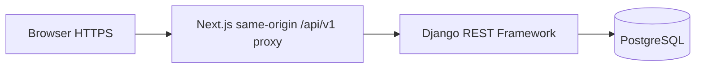

# Career Club Connect — Technical Spike Plan

**Status:** PLANNED ONLY — no application code, GitHub issues, hosting account, or deployed environment created.  
**Date:** 15 October 2026  
**Linked document:** `CAREER_CLUB_CONNECT_PRODUCT_SIGNOFF_ARCHITECTURE_LOCK.md` v1.1

## 1. Purpose and boundaries

Before committing to the full product, validate the highest-risk architecture claim: a mobile-first Next.js frontend can securely use Django REST Framework session authentication, CSRF, and PostgreSQL through a same-origin browser interface on the selected hosting arrangement. This is a **throwaway or minimal proof-of-concept**, not the start of building the entire application. No forum, experience library, Coffee Buddy, or career-action implementation belongs in this spike.

**Hypothesis:** A browser at one HTTPS public origin can register/log in with a secure Django session, access a protected `/api/v1/auth/session` endpoint, submit a CSRF-protected mutation, refresh without losing the session, log out, and lose access afterward. Database state persists across service restarts. No credentials or session tokens are placed in `localStorage`.

## 2. Candidate architecture

- Frontend candidate: Next.js App Router, React, TypeScript strict mode.
- Backend candidate: Python, Django, Django REST Framework, `django-cors-headers` only if required by an evidenced alternate architecture, PostgreSQL.
- Auth candidate: Django session cookies (`HttpOnly`, `Secure`, appropriate `SameSite`) and CSRF protection. Session and CSRF cookies must be forwarded/set correctly by the Next.js proxy; the proxy must not blindly pass arbitrary user-controlled upstream URLs or privileged headers.
- API convention: `/api/v1/` JSON endpoints with explicit validation and generic error shape.
- Infrastructure candidate: separate web/API services behind one browser-visible HTTPS origin and managed PostgreSQL. Provider, costs, exact topology and database tier are **not selected**.

## 3. Spike endpoints (experiment only)

| Method | Path | Intent | Required evidence |
|---|---|---|---|
| `GET` | `/api/v1/health/live` | Process is up | 200 without credentials |
| `GET` | `/api/v1/health/ready` | Database connection works | 200 when DB reachable, failure when DB unavailable |
| `GET` | `/api/v1/auth/csrf` | Establish CSRF cookie/token | Browser can submit subsequent protected POST |
| `POST` | `/api/v1/auth/login` | Authenticate synthetic test user | Session cookie established securely |
| `GET` | `/api/v1/auth/session` | Return minimal current user | 200 for valid session; 401 for guest |
| `POST` | `/api/v1/spike/protected` | CSRF-protected write to test table | Valid token succeeds; missing/invalid token rejected |
| `POST` | `/api/v1/auth/logout` | End session | Refresh remains logged out |

**Security note:** Exact Django/DRF middleware, authentication classes, CSRF issuance and HTTP status choices are to be verified during the spike and documented in ADR-002; do not assume DRF's default session behavior is sufficient for every endpoint. Never disable CSRF as a workaround.

## 4. Acceptance tests — must run on real HTTPS hosts

| Test ID | Scenario | Pass condition |
|---|---|---|
| SP-01 | Anonymous session check | No personal information returned |
| SP-02 | Login valid demo credentials | Secure session established; no token in browser storage |
| SP-03 | Login invalid credentials | Rejected with generic message; rate limiting demonstrated or separately evidenced |
| SP-04 | Protected GET after login | Current user returned; no other user's data |
| SP-05 | Protected POST with CSRF | Succeeds and persists a DB row |
| SP-06 | Protected POST without CSRF | Rejected; no row created |
| SP-07 | Reload and direct-link | Session survives refresh and browser navigation |
| SP-08 | Logout then refresh | Session invalid; protected endpoint denied |
| SP-09 | Cookie inspection | `Secure`, `HttpOnly` on session cookie; correct domain/path/SameSite; no cross-site leaks |
| SP-10 | Restart backend/frontend | Database row and expected session behavior preserved |
| SP-11 | Browser mobile emulation | Login/logout works at 390px and desktop 1440px |
| SP-12 | Proxy abuse attempt | Proxy rejects unsupported methods/paths/host targets; no open proxy behavior |
| SP-13 | Cross-account request | User A cannot access user B's private row |
| SP-14 | Hosting operational check | HTTPS, environment secrets, migration execution, health/readiness and basic rollback documented |

## 5. Work sequence — 1–2 days, timeboxed

1. **Decision and costing (30–60 min):** shortlist hosting choices based on actual current pricing, EU region availability, HTTPS, managed PostgreSQL, domain routing, deployment logs and secrets. Record estimated monthly cost and free-tier limitations. Do not claim a provider is selected until verified.
2. **Repository preparation (45–90 min):** establish monorepo folders `apps/web`, `apps/api`, `docs`, `infra`, a minimal `.env.example`, Git ignore rules, formatting/lint/test commands and a basic GitHub Actions check. This is a proposed next step, not performed now.
3. **Minimal Django API (1–3 h):** custom user if required by architecture, session/CSRF endpoints, one test table, migrations, and isolated tests.
4. **Minimal Next.js browser flow (1–3 h):** login form, session display, protected test button, logout, proxy routes, visible errors. Use design tokens but **do not** implement product screens.
5. **Real HTTPS deployment (1–3 h):** deploy both services and managed DB, run migrations, configure cookies/CSRF/proxy and collect evidence.
6. **Security tests and decision (1–2 h):** run SP-01–SP-14, record pass/fail and screenshots/log snippets with credentials redacted; choose keep/revise architecture in ADR-002 and ADR-009.

Time estimates are planning ranges, not commitments. If blocked for >2 hours by cookie/proxy mechanics, compare a simpler Django-rendered/HTMX frontend or a single-origin reverse-proxy arrangement rather than adding insecure workarounds.

## 6. Deliverables and evidence

- `docs/adr/ADR-002-session-auth.md`: decision, alternatives, cookie/CSRF evidence, risks.
- `docs/adr/ADR-009-hosting.md`: provider, region, monthly cost, architecture, backup/restore strategy.
- `docs/SPIKE_RESULTS.md`: dated table of SP-01–SP-14 pass/fail, exact deployment topology, redacted screenshots, unresolved issues.
- Minimal code for proof of concept only, with tests and `.env.example`; never commit actual secrets.
- A **go / revise / stop** decision: full app work may begin only when security-critical SP-02, SP-04–SP-09, SP-12 and SP-13 pass and hosting costs are accepted.

## 7. Remaining blocking decisions

### Owner decisions required before full product implementation

1. **D01/D02:** confirm five mobile tabs, desktop sidebar, and the exact design tokens as implementation baseline.
2. **D04/D05:** confirm named-only forum posting and anonymous experience publication with moderator-visible attribution.
3. **D06–D08/D13–D15:** confirm synthetic initials avatars, optional hidden LinkedIn, unverified round claims, private-by-default profiles, Coffee Buddy opt-in, no photo uploads and no contact exchange.
4. **D12/D16:** confirm the demo account deletion/export experience, with honest limitations and documented handling of public contributions and moderation logs. Legal retention/controller decisions for a real pilot are **not** resolved by this approval.
5. **Forum safeguards:** agree what open sign-up needs at minimum (email verification, request throttling, moderation/reporting, anti-spam measures), including email provider costs and the rule that unverified users cannot claim verified membership.
6. **Scope deadline:** agree that P0 must ship before forum/Coffee Buddy P1, and conditional notifications can be omitted without misleading UI.

### Technical decisions blocked on spike evidence

- Hosting provider, region, pricing, domain/proxy arrangement and backups.
- Actual Django cookie/CSRF/proxy implementation, session expiration, reset-email approach and anti-abuse solution.
- Performance/operational evidence sufficient for a demonstration; database migration and deployment rollback approach.

### Future pilot dependencies — NOT required to present the synthetic demo

- Espoo/Career Club branding and organizer permission; no implied endorsement.
- Consent-based access to former participants, verified alumni claims and an administrator.
- Controller/processor roles, privacy notice, retention schedule, lawful basis, moderation staffing and incident response.
- Separate pilot database and account invitation/verification policy. Never convert synthetic identities into real alumni.

## 8. Proposed GitHub issues (drafts; not created)

| Issue | Title | Priority | Acceptance |
|---|---|---|---|
| CCC-001 | Record four approved product choices and outstanding sign-off | P0 | Decision register reflects partial approval |
| CCC-002 | Prepare minimal repo and CI scaffold | P0 | CI runs lint/typecheck/tests; secrets ignored |
| CCC-003 | Spike session cookies, CSRF and same-origin proxy | P0 | SP-01–SP-13 evidence collected |
| CCC-004 | Evaluate hosting and deploy minimal stack | P0 | SP-14 evidence, price/region/backup ADR |
| CCC-005 | Review remaining owner decisions | P0 | D01–D16 each approved/deferred/rejected |
| CCC-006 | Record go/revise/stop architecture decision | P0 | ADR-002 and ADR-009 signed after results |

Suggested GitHub Project columns: `Backlog → Ready → In progress → Review → Done`, with `Blocked` as a separate state. Commit on meaningful testable increments; no artificial commits to increase activity.

## 9. Scope-change and demo safety rules

- Public forum **reading** is approved; public writing is not. All public serializers must exclude private or hidden data.
- Open **demo** registration must never grant moderator privileges or a verified alumni label.
- Approved experience edits must create pending revisions, leaving the last approved content unchanged until a moderator decides.
- Notifications are conditional P1; no database/UI dependency may prevent the core P0 flow from shipping.
- No actual personal data or participant photos are required for the spike. Use obviously fictional accounts and local test credentials only.
- A new feature requires impact review for screens, DB, API, auth, privacy, fixtures, tests, documentation and deadline before approval.

**Next milestone:** Owner approves remaining blocking product decisions and chooses an acceptable hosting budget. Then the minimal technical spike can be implemented and tested; **full application coding is not authorized by this planning document.**
