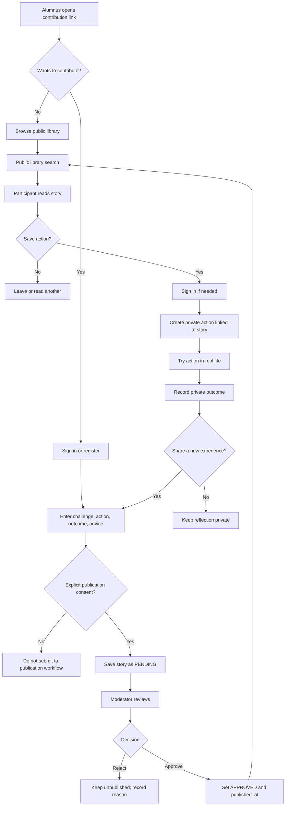
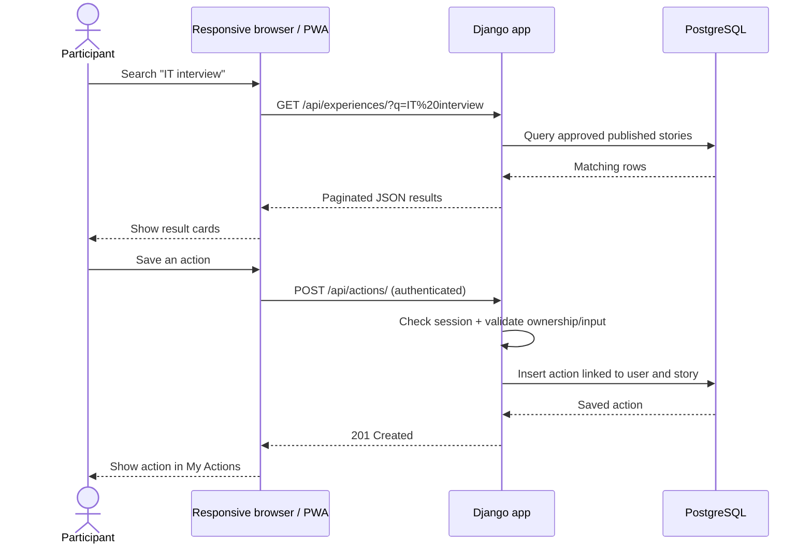
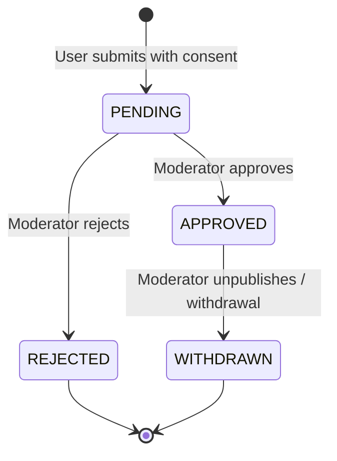
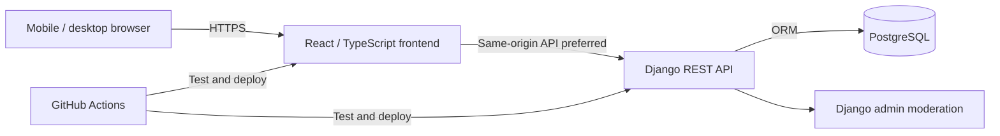
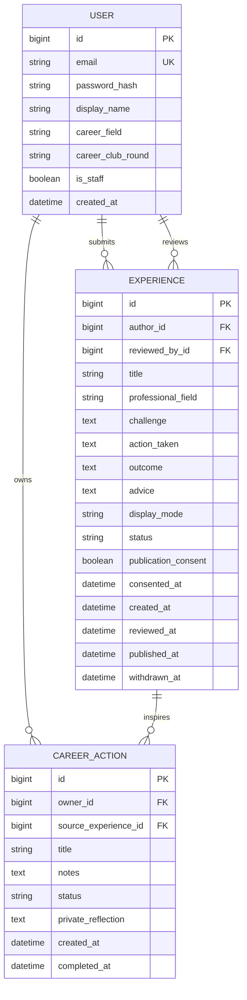

# Career Club Connect — Project Blueprint

**Version:** 0.1 (planning baseline)  
**Prepared:** 14 October 2026  
**Target demo:** 6 November 2026  
**Status:** Proposed MVP, pending validation with Espoo Career Club coordinator  
**Product type:** Mobile-first, responsive Progressive Web App (PWA)  
**Audience:** Current and future Espoo Career Club participants, alumni contributors, and a pilot moderator  
**Project purpose:** Real Career Club prototype **and** explainable full-stack engineering portfolio.

> **Important:** This is an independent prototype, not an official City of Espoo product. The product name, branding, alumni access, and any future organizational adoption require appropriate approval. The central problem is a hypothesis to validate, not a confirmed gap in existing Career Club services.

---

## 1. Executive summary

Career Club Connect helps knowledge from one Career Club round become useful to later rounds. Alumni voluntarily contribute **structured, experience-based stories** about a career challenge, an action they tried, the outcome, and advice. A moderator checks submissions before publication. Participants search and read approved experiences, save a concrete action to their private list, and later record what happened. Their follow-up can optionally become a new contribution, subject to review.

**Core loop:** `Contribute → Review → Discover → Act → Reflect → (optionally) Contribute`.

The product is intentionally **not** a generic professional network, job board, social feed, AI coach, or replacement for Career Club's existing sessions and alumni community.

### 1.1 Product hypothesis

*Career Club participants would benefit from a searchable, structured, consent-based record of practical career experiences from earlier rounds, especially if they can convert those experiences into actions and reflect on outcomes.*

**Validation needed:** Ask the coordinator whether such a resource already exists; ask current participants what they struggle to retrieve; ask alumni whether they would voluntarily contribute.

### 1.2 One-sentence pitch

> Career Club Connect helps each Career Club round learn from earlier rounds: discover what others tried, take a practical step, and pass the learning forward.

### 1.3 MVP success definition

The MVP succeeds when a real volunteer can submit a story, a moderator can approve it, another user can find it, save a related action, and record a follow-up — all on a phone through a deployed HTTPS site.

---

## 2. Scope and constraints

### 2.1 Must-have functionality (MVP)

| ID | Feature | Acceptance criterion |
|---|---|---|
| M01 | Registration and login | A participant can create an account, sign in/out, and access private actions. |
| M02 | Experience submission | An authenticated contributor submits a challenge, action, outcome, and advice; submission starts unpublished. |
| M03 | Moderation | A moderator can approve/reject a submission; rejected and pending content never appears publicly. |
| M04 | Experience library | Visitors can browse published stories; search by text and filter by topic/field. |
| M05 | Experience detail | A visitor can read a structured story, its contribution date, and its limitations/context. |
| M06 | Save practical action | A signed-in participant can create/save an action inspired by an experience. |
| M07 | Follow-up | The participant can mark the action tried and privately record what happened. |
| M08 | Privacy controls | Submission requires explicit publication choice; users can request withdrawal/removal; no contact details displayed. |
| M09 | Mobile-first design | Key flows work at 360px width and on modern desktop browsers. |
| M10 | Production baseline | HTTPS, environment secrets, automated tests, deployed application, health check, error handling. |

### 2.2 Conditional / stretch features

- PWA install prompt and offline application shell (only after the core online workflow works).
- Save/bookmark an experience without creating an action.
- Helpful/not helpful feedback, with rate limiting and no public popularity ranking.
- Coordinator analytics with aggregate counts only.
- Export personal actions to CSV.

### 2.3 **Not in the first release**

- Coffee Buddy matching, invitations, or scheduling.
- Community feed, comments, direct messages, chat, or follower system.
- AI-generated advice, AI matching, scraping LinkedIn, or importing alumni contacts.
- City of Espoo internal systems, official authentication, job board, live event integrations.
- Native Android/iOS apps or push notifications.
- Automatic verification of employment outcomes.

These can be designed as future modules, but **must not delay the first usable product**.

### 2.4 Delivery constraints

- One primary developer, supported by AI-generated code and explanations.
- Approximately three weeks for development, testing, and a live demonstration.
- User performs account authorization, local commands, testing, and any hosting approvals as needed.
- Pilot participation is voluntary; no assumption of access to prior Career Club cohorts.

---

## 3. Personas and permissions

| Role | Goal | Can do | Cannot do |
|---|---|---|---|
| Visitor | Learn from alumni experiences | Browse/search published stories | Read drafts or private follow-ups |
| Participant | Apply useful advice | Register, search, submit stories, create own actions and reflections | Moderate others' content |
| Alumni contributor | Share practical experience | Same contribution functions as participant | Claim verified alumni status without verification |
| Moderator | Keep shared library safe and useful | Review pending stories, approve/reject, unpublish | Read participants' private action reflections by default |
| Site administrator | Operate the service | Manage accounts, roles, security, and system configuration | Bypass documented privacy/consent rules as ordinary product behavior |

**Role design decision:** Participants and alumni use one `User` model. `career_club_round` is optional, self-declared metadata; alumni status is not verified in MVP. Moderator access is assigned manually by an administrator. Django admin is sufficient for first-release moderation if a polished moderator UI would jeopardize delivery.

---

## 4. Detailed user journeys

### Journey A — Alumni contribution

1. Coordinator shares a voluntary invitation containing the application link, if agreed.
2. Alumni visitor reads the privacy and publication explanation.
3. Contributor creates an account or signs in.
4. Contributor fills in `professional_field`, `challenge`, `action_taken`, `outcome`, `advice`, optional `career_club_round`, and publication preference.
5. Backend validates lengths and required fields; submission is saved with status `PENDING`.
6. Moderator reviews and approves or rejects. Rejection is not public.
7. On approval, a publishable story appears in the experience library. A contributor can request withdrawal later.

### Journey B — Future participant discovers and acts

1. Visitor opens the experience library without needing an account.
2. Visitor searches for `IT interview` and optionally filters by professional field.
3. Backend returns **approved, published** stories only.
4. Visitor opens a story and reads the challenge, action, outcome, and advice.
5. Visitor clicks **Try a practical action**; login is required.
6. Participant creates a specific, personal action (e.g., `Rewrite one portfolio project description`), optionally linked to the story.
7. Participant later records `TRIED` and a private reflection.
8. Participant can choose to create a separate new experience from their own learning; no private reflection is published automatically.

### Journey C — Moderator protects the library

1. Moderator signs into the restricted admin interface.
2. Sees pending stories, creation dates, and content.
3. Checks for personally identifying details, advertising, unsafe content, unsupported claims, and whether consent was recorded.
4. Approves, rejects with internal reason, or requests edits through an out-of-band contact process in MVP.
5. Approval records `reviewed_by`, `reviewed_at`, and `published_at`.
6. Moderator can unpublish a story if a contributor requests withdrawal or a problem is discovered.

---

## 5. System flowcharts

### 5.1 Complete user and content lifecycle



### 5.2 HTTP request and data flow



### 5.3 Story moderation state machine



**Invariant:** Only `APPROVED` stories with a non-null `published_at` are accessible through public list/detail endpoints. Direct URL access must obey the same rule.

---

## 6. Proposed system architecture

### 6.1 Recommendation

**Django + Django REST Framework + PostgreSQL + React/TypeScript frontend**, with a responsive UI and optional PWA service worker after MVP completion.

Why: Django provides mature authentication, ORM, migrations, and admin moderation; PostgreSQL supports reliable relational storage and text search; React/TypeScript offers a polished mobile UI and demonstrates a modern frontend/API boundary. **Risk:** A two-application frontend/backend deployment increases setup complexity. If the timeline slips, a Django-rendered frontend with HTMX is a legitimate simplification, not a failure.



### 6.2 Authentication and session design

Prefer **server-managed, HttpOnly, Secure session cookies** over storing long-lived authentication tokens in browser local storage. Use CSRF protection on unsafe requests. Ideally deploy frontend and API under one origin to avoid cross-origin cookie complexity. If hosting constraints require separate origins, revisit cookie/CORS/CSRF design before implementation.

### 6.3 Application boundaries

- `accounts`: authentication, user profile, optional career field and round.
- `experiences`: submissions, public browsing, moderation status, search.
- `actions`: private saved actions and follow-ups.
- `core`: health check, shared API error handling, configuration.
- `frontend`: routing, accessible forms, search, experience detail, action dashboard.

---

## 7. Database design (MVP)

### 7.1 Entity relationship diagram



**Notation:** `reviewed_by_id` and `source_experience_id` are nullable; each experience has exactly one author. One user can author many experiences and own many actions. One experience can inspire many users' actions.

### 7.2 Field-level design

#### User

Use a **custom Django user model from the first migration**, authenticating by unique normalized email. Fields: `id`, `email`, `password` (Django salted hash), `display_name`, optional `career_field`, optional `career_club_round`, `is_active`, `is_staff`, `date_joined`. Avoid collecting phone, address, birth date, employer, or immigration details.

#### Experience

| Field | Type / constraint | Reason |
|---|---|---|
| `id` | bigint primary key | Stable internal identifier |
| `author_id` | FK User, `PROTECT` or controlled deletion | Ownership and withdrawal workflow |
| `title` | varchar(120), required | Search result summary |
| `professional_field` | varchar(80), required | Filter |
| `challenge` | text, 30–1500 chars | Context |
| `action_taken` | text, 30–1500 chars | Concrete action |
| `outcome` | text, 20–1500 chars | What happened, including unsuccessful outcomes |
| `advice` | text, 20–1000 chars | Reusable lesson |
| `display_mode` | enum `ANONYMOUS`, `DISPLAY_NAME` | Public identity choice |
| `status` | enum `PENDING`, `APPROVED`, `REJECTED`, `WITHDRAWN` | Publication workflow |
| `publication_consent` | boolean, must be true to submit | Explicit permission |
| `consented_at` | timestamp, required | Consent audit |
| `reviewed_by_id` | nullable FK User | Moderator audit |
| `reviewed_at` | nullable timestamp | Review audit |
| `published_at` | nullable timestamp | Public visibility |
| `withdrawn_at` | nullable timestamp | Withdrawal audit |
| `created_at`, `updated_at` | timestamps | Maintenance |

**Publication rule:** Even when a story is displayed anonymously, the service stores its author account privately for moderation and withdrawal. Anonymous display does **not** equal anonymous data collection.

#### CareerAction

| Field | Type / constraint | Reason |
|---|---|---|
| `id` | bigint primary key | Identifier |
| `owner_id` | FK User, required | Strict private ownership |
| `source_experience_id` | nullable FK Experience, `SET_NULL` | Optional inspiration source |
| `title` | varchar(160), required | Concrete next step |
| `notes` | text, optional, max 1000 chars | Private plan |
| `status` | enum `PLANNED`, `TRIED`, `CANCELLED` | Progress |
| `private_reflection` | text, optional, max 2000 chars | Private learning |
| `created_at`, `updated_at`, `completed_at` | timestamps | History |

**Privacy rule:** An action's source story can be public, but the action itself is always visible only to its owner and authorized system operators performing necessary maintenance; it is never included in public responses.

### 7.3 Indexes and constraints

- Unique case-insensitive user email (implementation via normalization and DB constraint).
- Experience composite index on `(status, published_at)` for public browse.
- Experience index on `professional_field`.
- PostgreSQL full-text search on approved story text; start with `SearchVector` / `SearchQuery` and use a GIN index if needed after profiling.
- Action composite index on `(owner_id, created_at)`.
- Model-level and serializer-level validation; never rely on frontend validation alone.
- All timestamps stored in UTC; displayed in the user's local timezone.

### 7.4 Deletion / withdrawal decisions

- Story withdrawal removes it from public endpoints immediately; define a documented retention/deletion procedure before pilot data collection.
- Users can request account deletion and removal of their contributions; handle linked actions and audit records carefully.
- Backups may retain deleted data temporarily under the documented retention policy.
- Do not silently re-publish withdrawn stories.

---

## 8. API contract (proposed v1)

All endpoints prefixed `/api/`. JSON for application requests/responses. Use standard HTTP statuses and consistent validation errors.

| Method | Path | Access | Purpose |
|---|---|---|---|
| POST | `/auth/register/` | Visitor | Register |
| POST | `/auth/login/` | Visitor | Create authenticated session |
| POST | `/auth/logout/` | Signed-in | End session |
| GET | `/auth/me/` | Signed-in | Current user |
| GET | `/experiences/` | Public | Paginated published stories; `q`, `field`, `page` |
| GET | `/experiences/{id}/` | Public | One published story only |
| POST | `/experiences/` | Signed-in | Submit pending story |
| GET | `/experiences/mine/` | Signed-in | Own submissions and statuses |
| GET | `/actions/` | Signed-in | Own actions only |
| POST | `/actions/` | Signed-in | Create own action |
| PATCH | `/actions/{id}/` | Owner | Update own action and reflection |
| DELETE | `/actions/{id}/` | Owner | Delete own action |
| GET | `/health/` | Public | Minimal health response, no secrets |

**Moderation:** Initially via Django admin; avoid building separate moderation endpoints until there is a real need. Any later moderation endpoints require explicit staff permission checks.

### 8.1 Example response — experience

```json
{
  "id": 42,
  "title": "Preparing for my first interview",
  "professional_field": "Technology",
  "challenge": "I struggled to explain my previous projects.",
  "action_taken": "I rewrote my project descriptions using specific outcomes.",
  "outcome": "I felt better prepared for interviews.",
  "advice": "Prepare two concrete examples from your own work.",
  "author_display": "Anonymous Career Club contributor",
  "published_at": "2026-10-22T10:00:00Z"
}
```

Example only; no real alumni testimony is implied. **Never** expose author email, private user ID, moderation notes, or consent audit data in public response serializers.

### 8.2 Authorization rules

- Public experience list/detail: approved and published only.
- Submission: authenticated user, `status` forced to `PENDING` server-side.
- Own submissions: filter `author=request.user`.
- Own actions: filter `owner=request.user` in queryset **and** object-level permission.
- Moderator: `is_staff` and explicit model permissions.
- Rate-limit registration, login, submissions, and search if abused.

---

## 9. Screens and navigation

### 9.1 Public screens

1. **Landing:** what the product does, clear disclaimer, `Explore experiences`, `Share experience`.
2. **Experience library:** search, field filter, result cards, empty-state suggestions.
3. **Experience detail:** challenge → action → outcome → advice; `Try an action` CTA.
4. **Login / Register:** minimal accessible form, privacy links.

### 9.2 Signed-in screens

5. **Share experience:** structured contribution form and publication consent.
6. **My submissions:** pending/approved/rejected/withdrawn statuses.
7. **My actions:** planned/tried/cancelled action cards and private reflection editor.
8. **My profile:** display name, optional career field/round, account/privacy controls.

### 9.3 Moderator screens

9. **Django admin:** pending submission list, content inspection, approve/reject/unpublish actions, audit fields.

### 9.4 Mobile navigation

Bottom navigation (mobile): **Explore**, **My Actions**, **Share**, **Profile**. Desktop: simple top navigation. Avoid empty tabs for unbuilt modules. Show login when accessing private routes, then return to the intended page.

### 9.5 Accessibility

- Semantic labels, keyboard navigation, visible focus states, sufficient contrast.
- Large touch targets, clear errors, no essential hover-only interactions.
- Test narrow screen (360px), typical phone, tablet, desktop.
- Avoid presenting career outcomes as verified facts.

---

## 10. Security, privacy, and trust

This is a real-user application, so privacy and abuse prevention are part of MVP scope, not optional polish.

1. **Data minimization:** no phone numbers, immigration data, private addresses, CV uploads, or employer contact details.
2. **Consent:** separate, explicit publication consent with clear anonymous/display-name choice; no pre-checked box.
3. **Privacy notice:** identify the actual operator/controller, purpose, storage, retention, contact for withdrawal, and hosting provider before accepting pilot data.
4. **Access control:** private actions and unpublished stories restricted server-side; test IDOR (changing IDs in URLs).
5. **Authentication:** Django password hashing, Secure/HttpOnly cookies, CSRF protection, HTTPS, secure reset mechanism if implemented.
6. **Input safety:** server-side validation, HTML escaping, avoid rendering raw user HTML; sanitize any future rich text.
7. **Moderation:** all public contributions reviewed before publication; reporting/withdrawal contact visible.
8. **Secrets:** `.env` excluded from Git; environment variables in hosting; rotate compromised keys.
9. **Database:** managed backups, least-privilege DB credentials, no publicly exposed DB port.
10. **Logging:** log errors and security events without dumping story content, passwords, session cookies, or private reflections.
11. **Third-party analytics:** avoid unnecessary tracking in the pilot.
12. **PWA caching:** never cache authenticated private API responses in a shared offline cache.

**Open decision:** Whether user-submitted experiences may mention other people or employers; initial rule should forbid identifying third parties without permission.

---

## 11. Testing strategy and release gates

### 11.1 Backend tests (pytest / pytest-django)

- Anonymous users can list approved stories but not pending, rejected, or withdrawn stories.
- Direct detail endpoint returns 404 for unpublished story IDs.
- User cannot create an approved story by sending `status=APPROVED` in JSON.
- Moderator approval sets audit fields.
- Participant A cannot view/update/delete Participant B's actions (including guessed IDs).
- Invalid submission fails with useful field errors.
- Missing consent prevents public submission.
- Search returns matching published stories and excludes drafts.
- Withdrawn stories disappear from search and detail endpoints.
- Registration does not allow duplicate email case variants.

### 11.2 Frontend tests (Playwright)

- Search and open experience on a 360px mobile viewport.
- Register/login/logout.
- Submit story and see pending status.
- Create action from published story; mark tried and save reflection.
- Signed-out user cannot access private actions.
- Keyboard navigation and essential form validation.

### 11.3 Manual user acceptance test

Ask 3–5 volunteers to complete one specific task each, without explaining the UI. Observe where they get stuck. Record task completion and feedback; do not claim usability from an untested demo.

### 11.4 Release gates

- No broken primary flow.
- No unauthorized access to private actions or drafts.
- All migrations apply on a clean database.
- Tests pass in CI.
- HTTPS live URL accessible on phone and desktop.
- Real data published only with permission and review.
- Clear independent-project disclaimer and withdrawal contact.

---

## 12. Repository structure (proposed)

```text
career-club-connect/
├── README.md                    # Recruiter-friendly overview, screenshots, quick start
├── PROJECT_BLUEPRINT.md         # This specification
├── docs/
│   ├── ARCHITECTURE.md          # Why each component exists
│   ├── DATABASE.md              # ERD, models, migrations, design decisions
│   ├── API.md                   # Endpoints, request/response examples
│   ├── SECURITY_PRIVACY.md      # Threats, permissions, consent
│   ├── DEPLOYMENT.md            # Hosting, configuration, rollback
│   ├── TESTING.md               # Test plan and evidence
│   ├── LEARNING_LOG.md          # Concepts learned and code explanations
│   └── DECISIONS.md             # Architecture decision records
├── backend/
│   ├── config/                  # Django settings, URLs, WSGI/ASGI
│   ├── accounts/                # Custom user and auth
│   ├── experiences/             # Stories, search, moderation
│   ├── actions/                 # Private actions/reflections
│   ├── core/                    # Shared helpers and health check
│   ├── tests/
│   ├── manage.py
│   └── requirements.txt
├── frontend/
│   ├── src/
│   │   ├── api/                 # Typed API client
│   │   ├── components/          # Reusable UI
│   │   ├── pages/               # Screens
│   │   ├── features/            # Experience/action/auth UI
│   │   └── types/               # TypeScript types
│   └── package.json
├── .github/workflows/ci.yml
├── .env.example
├── .gitignore
└── docker-compose.yml
```

The tree is **planned**, not yet implemented. Each file will be created only when its purpose is understood.

---

## 13. Deployment approach

### 13.1 Principles

- One public HTTPS URL; frontend and backend under the same origin where possible.
- Managed PostgreSQL with backups.
- Environment-based configuration: `DEBUG=False`, allowed hosts, secret key, DB URL, secure cookies, CSRF trusted origins.
- Run migrations deliberately during deployment.
- Collect static assets and serve correctly.
- CI executes tests before release.
- Domain name optional for MVP; hosting-provided subdomain is acceptable.

### 13.2 Hosting choice (not yet locked)

Select a provider after checking **current pricing, free-tier limits, PostgreSQL availability, deployment model, region, and operational constraints**. Avoid promising zero-cost hosting. Potential approaches include a single Django service that serves a built React frontend, or a frontend host plus Django API host; the single-origin option reduces authentication complexity.

### 13.3 Deployment runbook (to complete during implementation)

1. Create hosting account and project (user authorizes).
2. Provision database and record credentials securely.
3. Configure environment variables, allowed origins/hosts, HTTPS.
4. Build frontend; install backend dependencies; apply migrations.
5. Create administrator via secure one-time procedure.
6. Deploy; test health, login, search, story submission, moderation, and actions.
7. Check logs and backups; document rollback procedure.
8. Capture screenshots and publish non-sensitive demo content.

---

## 14. Three-week implementation schedule

**Dates are targets, not guarantees. Protect the final days for testing.**

| Dates | Deliverables | Exit condition |
|---|---|---|
| Oct 14–16 | Validate need, finalize blueprint, wireframes, consent/privacy decisions | Coordinator questions prepared; scope frozen |
| Oct 17–19 | Repository, Django project, custom user, PostgreSQL, frontend scaffold, CI | Clean setup works locally |
| Oct 20–22 | Experience model, submission, moderation, public library/search | Contribution-to-publication path works |
| Oct 23–25 | Authentication UI, detail pages, mobile styling | Main reading/contribution flows work on phone |
| Oct 26–28 | Private actions, follow-ups, ownership tests | Full core loop passes tests |
| Oct 29–31 | Deployment, security review, bug fixes, responsive testing | Public HTTPS URL and release gates pass |
| Nov 1–3 | Voluntary pilot, feedback, fixes, README, screenshots | Evidence of actual usability |
| Nov 4–5 | Demo rehearsal, presentation, contingency | Five-minute demo reproducible |
| Nov 6 | Career Club presentation | Live demo or verified recorded fallback |

**Scope-cut rule:** If behind schedule by Oct 26, cut PWA install polish, analytics, bookmarks, and any optional features. Never cut moderation, authorization, tests for private data, or core workflow.

---

## 15. Learning and explainability plan

The project should be understandable by the developer without memorizing generated code. Every completed feature gets a short entry in `docs/LEARNING_LOG.md`:

1. **Purpose:** What user problem does this feature solve?
2. **Files:** Which exact files implement it?
3. **Request flow:** Which URL → view/controller → serializer → model → DB query?
4. **Key concept:** Explain one Django/React/PostgreSQL concept in plain English.
5. **Security:** Who can access it and how is that enforced?
6. **Test:** How do we prove it works?
7. **Change exercise:** Make one small modification and predict the effect.

### 15.1 Minimum topics to master

- HTTP request/response and REST semantics.
- Django project vs app; URL routing; views; serializers; ORM; migrations.
- Custom user, password hashing, sessions, CSRF, and authorization.
- Foreign keys, joins, indexes, constraints, and PostgreSQL search.
- React components, props, state, forms, API calls, and TypeScript types.
- Client-side validation vs server-side validation.
- Testing pyramid, fixtures, integration tests, and Playwright.
- Environment variables, Docker, CI/CD, hosting, logs, and backups.
- PWA manifest/service worker and safe caching (only if implemented).

### 15.2 Explain-the-code checkpoint

Before marking a feature complete, the developer should be able to answer:

> “When I press this button, which frontend function runs, which HTTP request is sent, which backend permission check occurs, which database row changes, and which test proves another user cannot access it?”

This is the standard for a credible GitHub portfolio, not simply copying code.

---

## 16. Portfolio and presentation deliverables

### GitHub

- Clear README with problem, users, scope, demo link, architecture image, tech stack, screenshots, setup, tests, security notes, and limitations.
- Meaningful commit history by feature, not one massive code dump.
- Issue tracker / milestone checklist and architecture decision records.
- No `.env`, passwords, real personal data, or private pilot feedback in the repository.
- Automated CI badge only after CI genuinely runs.

### Career Club pitch (five minutes)

1. **0:00–0:40 — Problem:** What future rounds may struggle to access.
2. **0:40–1:20 — Why existing tools are insufficient:** Demonstrate the *specific* missing structured experience-to-action workflow, if validated.
3. **1:20–3:30 — Live demo:** Approved alumni story → search → save action → reflect.
4. **3:30–4:15 — Real pilot evidence:** Number of volunteers, stories, completed test tasks; only report actual measured data.
5. **4:15–5:00 — Future use:** How future rounds might contribute, limitations, and request for a small follow-up pilot.

Prepare a short recorded demo as a fallback for unreliable internet; do not present staged testimonials as real.

---

## 17. Product risks and mitigations

| Risk | Impact | Mitigation |
|---|---|---|
| Existing alumni tool already solves this | No compelling product need | Validate with coordinator before coding heavily |
| Too few alumni contributions | Empty experience library | Begin with 3–10 consented stories; useful search even with small dataset |
| Stories contain private details | Privacy harm | Clear form warnings, moderation, withdrawal |
| Advice is inaccurate/outdated | Misleading users | Label as personal experience, include date, allow unpublishing |
| No organizer to maintain content | Product decays | Keep moderation simple; define handover and ownership |
| Overengineering | Missed deadline | Strict MVP; no social feed or chat |
| Two-app deployment complexity | Delay/security bugs | Prefer same-origin; switch to Django templates if necessary |
| No official Espoo endorsement | Branding/adoption confusion | Independent-project disclaimer; ask permission before official use |
| PWA offline caching leaks private data | Data exposure | Cache only safe static assets, not authenticated API responses |

---

## 18. Questions to resolve before implementation

### Coordinator / Career Club

1. Is there already a searchable collection of practical alumni experiences, rather than a communication group or event archive?
2. Would future participants find this useful, or is another unmet need more pressing?
3. May we invite a small number of alumni to contribute voluntarily using a short form?
4. May we refer to the Career Club name in an independent pilot, with a clear non-official disclaimer?
5. Could a coordinator review the prototype and advise on a small pilot in a future round?

### Product / legal / operations

6. Who will be the actual operator/data controller during the pilot?
7. Which hosting provider and region will be used, and what is the realistic budget?
8. Who will moderate content and respond to withdrawal requests?
9. What exact retention and account-deletion process will be published?
10. Should users be able to browse without an account? **Recommendation: yes.**

### Technical

11. Can frontend and API share one origin on the chosen host?
12. Is email verification necessary for this pilot, and which email provider is approved?
13. Do we need password reset before inviting external testers? **Recommendation: yes, or use a secure alternative.**
14. Is PWA installability worth implementing after the core workflow? **Recommendation: yes if time allows.**

---

## 19. Definition of done

The MVP is **done** only when:

- [ ] Problem hypothesis has been tested with at least a few actual Career Club stakeholders.
- [ ] App works on a real mobile browser and desktop.
- [ ] Visitor can search/read approved experiences.
- [ ] Volunteer can register and submit an experience with informed publication choice.
- [ ] Moderator can approve, reject, and unpublish experiences.
- [ ] Participant can create a private action from a story and record an outcome.
- [ ] Unauthorized users cannot read others' private actions or unpublished stories.
- [ ] Tests run successfully in CI.
- [ ] App is deployed with HTTPS and secrets outside Git.
- [ ] Privacy notice, operator contact, and withdrawal route are available.
- [ ] README, diagrams, API docs, test evidence, and learning log are complete.
- [ ] Developer can explain the full core request flow without reading generated code line by line.
- [ ] Five-minute demo is rehearsed with a backup plan.

---

## 20. Future roadmap (explicitly outside MVP)

**Phase 2 — Coffee Buddy:** Opt-in professional interests, consented availability, request/accept/decline, no automatic public contact details, safety and reporting controls. Validate demand and safeguarding before implementation.

**Phase 3 — Focused community updates:** Topic-based questions or moderated updates; avoid duplicating LinkedIn and existing Career Club channels.

**Phase 4 — Facilitator tools:** Curated topic collections, aggregate analytics, recurring questions, and cohort handover tools if organizers request them.

**Phase 5 — Additional integrations:** Only after permissions, privacy assessment, maintenance owner, and clear measurable need are established.

**Architectural principle:** Build the MVP as clean, separate Django apps and frontend features so future modules can be added without changing the meaning of the core experience/action workflow.

---

## 21. Change log

| Version | Date | Changes |
|---|---|---|
| 0.1 | 2026-10-14 | Initial scope, roles, detailed journeys, diagrams, ERD, APIs, privacy, testing, delivery, learning plan |

**Next step:** Review this blueprint together; resolve the open product and hosting decisions; then generate `README.md`, `docs/DECISIONS.md`, the initial repository, and the first working vertical slice.
